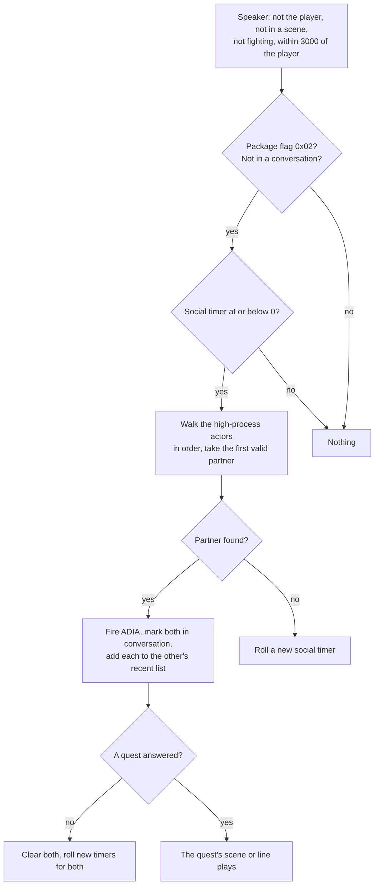
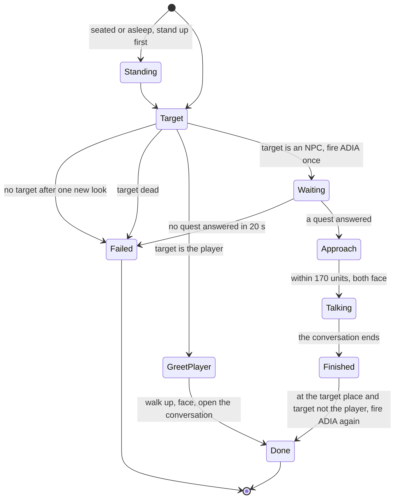
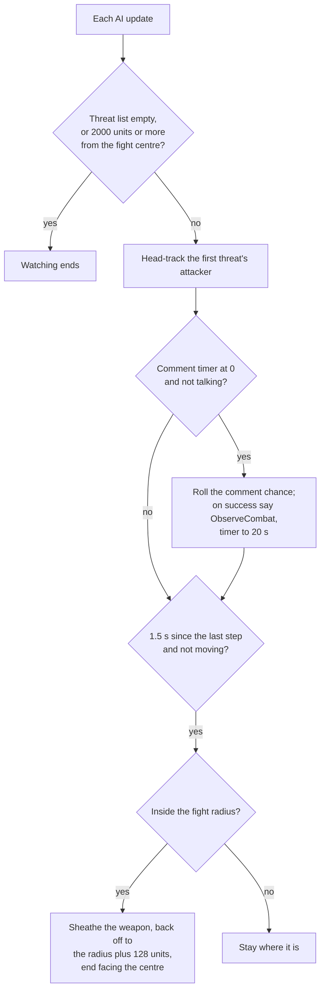

# Random conversations and NPC social events

NPCs in the game talk to each other, say hello in passing, watch a fight, and react to a dead
body. Talking, hellos, and bodies each send a [story-manager](/engine/story-manager.md) event,
and vanilla quests start from them: `ADIA` (actor dialogue), `AHEL` (actor hello), and `DEAD`
(dead body). The quest then plays the conversation as a [scene](/engine/scenes.md) or a line.
The engine itself says nothing between two NPCs: with no quest to answer `ADIA`, no line plays.

Sources: the Creation Kit pages "Scene" (section "Controlling Random Conversations"),
"Actor Dialogue Event", "Actor Hello Event", and "Package" (the interrupt flags).

## Package interrupt flags

An actor's current package decides what it may do. The package `PKDT` interrupt flags:

| Flag | Meaning |
| --- | --- |
| 0x01 | Hellos to the player ([dialogue](/engine/dialogue.md#speech-timers)) |
| 0x02 | Random conversations, and hellos in passing |
| 0x04 | Observe combat behaviour |
| 0x08 | Greet corpse behaviour |
| 0x80 | Idle chatter ([dialogue](/engine/dialogue.md#speech-timers)) |

An actor with no package takes part in nothing. A sandbox package whose "Allow Conversation"
option is on sets flag 0x02 on the running package when the procedure starts. Sandboxing adds
no other rule: the actor then follows the random conversation check below. A commanded follower
follows the flags of the package it runs, like any other actor.

## Settings

| Setting | `Skyrim.esm` | Meaning |
| --- | --- | --- |
| `fAISocialTimerForConversationsMin` | 10 | Shortest wait between tries, seconds |
| `fAISocialTimerForConversationsMax` | 30 | Longest wait between tries, seconds |
| `fAISocialRadiusToTriggerConversation` | 500 | Furthest partner, exterior |
| `fAISocialRadiusToTriggerConversationInterior` | 500 | Furthest partner, interior |
| `iAISocialDistanceToTriggerEvent` | 200 | How close a scene's pair must be before the talk starts |
| `fAISocialchanceForConversation` | 10 | Percent chance that a watcher of a fight comments |
| `fAISpectatorRememberThreatTimer` | 5 | Seconds a watcher remembers a threat |

`fAISocialchanceForConversationInterior` is in `Skyrim.esm` but the game never reads it. A random
conversation has no chance roll.

The game also has values that are not in `Skyrim.esm`:

| Value | Meaning |
| --- | --- |
| 3000 units | Both actors of a conversation must be this close to the player |
| 120 s | How often an actor forgets its recent partners |
| 20 s | How long `DialogueActivate` waits for a quest to answer its `ADIA` |
| 170 units | How close the speaker walks before the talk starts |
| 384 units | Added to the partner's radius for the walk's target place |
| 500 units | The scene's trigger distance when the speaker sees the partner, or both sit or sleep |
| 400 units | How far an actor reacts to a body |
| 20 s | How long a checked body waits before another actor reacts to it |
| 2000 units | A watcher of a fight stops watching at this distance from the fight's centre |
| 100 units | How close the finder of a body walks to it |
| 20 s | Shortest time between two comments of one watcher |

## Random conversations (`ADIA`)

The check runs each frame for each actor in high process (the actors near the player that get
full AI). One actor's check:

The social timer is rolled between the two timer settings when the actor enters high process
and again after each try. It counts down only while the actor is not in a scene.

A valid partner:

- is not the player, has no combat target, and is not disabled or deleted;
- is not in a conversation, has no request waiting, and is not sleeping;
- is within the social radius of the speaker (the interior setting indoors). Indoors the height
  difference must also be under 90 units.

Both actors must also be alive, not knocked down, and not unconscious. Both must run a package
with flag 0x02, be within 3000 units of the player, stand or sit (not part way into or out of a
seat), say no line, and not talk with the player. No pair is searched while an NPC's talk
package aims at the player.

Each actor keeps a list of recent partners, and a partner on the list is skipped. A timer of
120 s empties the whole list, then starts again. It counts down only on frames when the check
runs, so an actor whose check stops keeps its list.

The event carries the speaker's location, `R1` the speaker, and `R2` the partner.

### When no quest answers

The event goes into the story manager's queue, like every other event. The queue runs once per
frame, oldest event first, with a small time budget per frame, so the walk for one `ADIA` ends
in the same frame or a few frames later. No timer runs on this path. When the walk ends, the
result goes back to both actors:

- No quest started: both actors leave the conversation at once, and their requests are cleared.
  The speaker rolls a new social timer.
- A quest started: both stay in the conversation, and both roll a new social timer.

The 20 s wait belongs only to `DialogueActivate` and the In Game Dialogue package, which send
their own `ADIA`.

When the answering quest's [scene](/engine/scenes.md#conversation-scenes) is about to begin, the
game checks both actors again by the partner rules above. A failed check stops the scene. A
partner that is in another dialogue makes the game try again after 1 s.

## Walking together

The answering quest's scene takes the pair. Both get an In Game Dialogue package. The target
place is the partner, with the partner's radius plus 384 units. The scene's trigger distance is
`iAISocialDistanceToTriggerEvent`, raised to 500 units when the speaker sees the partner or both
sit or sleep, plus 20 when the speaker sits.

- The scene pauses while the speaker walks. The partner gets a wait package, so it stays
  where it is.
- The speaker stops within 170 units of the partner, or the package's own radius when it has
  one. A height difference of more than 20 units adds 20 units to the radius.
- Once the speaker stands still, both turn to face each other, the partner gets the wait package
  again, and the scene resumes.
- A scene line starts only when each speaker's head points within
  `fAIMinAngleRangeToStartSceneDialogue` (20 degrees) of the partner. While the speaker moves at 5
  units a second or more, the limit is `fAIMaxAngleRangeMovingToStartSceneDialogue` (80 degrees).
- A speaker that enters combat on the way gives up the walk.
- The speaker walks. It runs only when the actor always runs. The walk has no time limit: the
  speaker paths again when its goal is more than 100 units from the partner.

### The partner's wait package

The wait package is a copy of the default object Wait-For-Dialogue Package, which is
`zzzDEFAULTzzzWaitForDialogue` (`0x01CC5A`) in `Skyrim.esm`. It has two steps: a wait with
timeout 0 and "stop" on, then a travel to its own place within 1000 units. The copy is marked
"Must Complete" and is released when the dialogue ends.

- A wait with timeout 0 never ends by itself, so the partner waits with no time limit. A wait
  with no timeout given lasts 10 s.
- The partner stands still. The package sets no idle and no facing; the facing comes from the
  turn when the speaker arrives. A seated partner does not turn.
- The partner gets the package only when its AI runs every frame: when `DialogueActivate` fires
  its `ADIA`, and when the speaker arrives within 170 units.
- When the speaker's conversation ends, `DialogueActivate` succeeds and the partner picks a new
  package. Only a package with the release mark is replaced.

## The `DialogueActivate` procedure

The package's topic parameter is not used. Only the target and the place are.

While it waits for an answer, the target gets the short wait package, when the target is in
high or middle-high process.

## Hellos in passing (`AHEL`)

`AHEL` comes from head tracking, not from the conversation check. It fires when an actor that is
not the player and not in a scene, and that walks along a path, picks a new head-tracking
target. The target must be another NPC, not the player and not in a scene, and the actor's
package must have flag 0x02. The event carries the location, `R1` the
actor, and `R2` the target. It does not use the greeting distance or timers of hellos to the
player.

The head-tracking target is chosen by the rules on the
[head tracking](/engine/head-tracking.md#the-default-target) page.

`AHEL` fires only when the new target differs from the old one, so an NPC greets another NPC in
passing only while the player is not a valid target.

## Watching a fight

Watching a fight is a reaction to detection. An actor starts to watch when it detects a fighter
and:

- the fighter is not the player, is alive, is in combat, and is not fighting the watcher;
- the watcher is not in combat, has no combat target, is not fleeing, and is not already
  watching;
- the watcher stands, sits, or sleeps, and runs a package with flag 0x04.

The watcher gets its actor base's spectator override package when it has one, otherwise a
Spectator package, unless it already runs a Guard-type package. A watcher in a scene does not
change package: the scene is told instead, and the scene's "observing combat" flags decide
whether it pauses or ends ([scenes](/engine/scenes.md#actor-behaviour-flags)).

A watcher is not free for a random conversation, because its new package has no flag 0x02.

### What a watcher does

The Spectator package has one step and never walks toward the fight. When it starts, the
watcher stands up from furniture if needed and ends any dialogue it is in.

The watcher keeps a list of threats: each attacker and its target. An entry is refreshed every
2 s while the watcher detects the attacker, and an entry not refreshed for
`fAISpectatorRememberThreatTimer` seconds (5 s in `Skyrim.esm`) is dropped.

The fight area is a box around every known attacker and target position. Each position is
widened by a threat distance: 512 units for melee and explosions, 256 for ranged attacks and
mines. The fight radius is the distance from the box's centre to the farthest participant, plus
that participant's threat distance.

The comment chance is `fAISocialchanceForConversation`, 10 percent in `Skyrim.esm`, indoors too.
The comment timer starts at 0, so the first comment can come as soon as watching starts. It
counts down only on updates that have a valid attacker. Watchers near the player update every
frame, so once the timer is over, a comment comes within a few frames.

## Finding a body (`DEAD`)

Finding a body is also a reaction to detection. It needs:

- a dead body within 400 units that no actor has reacted to in the last 20 s;
- a finder whose package has flag 0x08.

Then:

1. `DEAD` fires with `R1` the finder, `R2` the body, and the finder's location.
2. The finder ends any dialogue it is in.
3. The finder gets its actor base's dead-body override package when it has one, otherwise a
   ReactToDead package aimed at the body, with "Must Complete" on and its place near the body
   within 100 units.
4. The body's timer starts at 20 s, so no other actor reacts to it until the timer ends.

ReactToDead has three steps:

1. The finder walks to within 100 units of the body.
2. Within 400 units of the body, the finder says a `NoticeCorpse` line once, and waits while it
   speaks. A finder that the body remembers, most likely its killer, says nothing. Farther than
   400 units, the finder skips the line.
3. The finder stops any idle with the `ActionIdleStop` action, the package ends, and the finder
   picks a new package.

The finder does not stay at the body: there is no stay timer and no idle there.

## What a save keeps

For each high-process actor, the save keeps the idle chatter timer, the time of the last
conversation step, the recent-partner timer, the social timer, the waiting request, the greeting
timers, the partner, and whether it is in a conversation
([actor process data](/formats/ess-actor-process.md#high-block)). The recent-partner list itself
is not saved. Each body keeps its 20 s timer.

OpenSky keeps the social timer, the recent-partner timer, each body's timer, and a running
conversation with its partner, phase, and age. A load counts the times on from the clock at
the load. Like the game, it keeps no recent-partner list. It also keeps no fight watchers and
no hello look targets, which the next pass finds again.

## Where OpenSky differs

OpenSky runs the social pass every frame and counts times in real seconds. It follows the rules
above, with these differences:

- The story manager answers an `ADIA` in the frame of the event, so a pair with no quest ends
  in that frame. A pair whose quest started waits 2 s for the quest's scene to take the speaker,
  then ends. The game has no such timer.
- New watchers and new finders are searched once a second, not on each actor's own detection
  pass. Detection is a clear sight line.
- The default look target follows the game's rules for a free NPC within 2000 units of the
  player. The 12000 unit distance of a large creature is not built. The look lasts 10 s and is
  renewed at each pick. A walker is an actor that moved at 5 units a second or more since its
  last check.
- A speaker that has moved less than 8 units in 1 s of its walk to the partner is asked to walk
  again. A seated speaker needs this: it stands up first, and a walk asked during the exit
  clip of its seat is refused.
- The partner's wait package, the watcher's Spectator package, and ReactToDead are not package
  records. The social pass holds the actor's own package and moves the actor itself. An actor
  base's spectator and dead-body override packages are not read.
- A finder that cannot reach its body gives up after 30 s. It still says its line within 400
  units. The package ends when the line starts, not when it ends.
- A watcher's comment is rolled without a check that the watcher is talking.
- `DialogueActivate` with the player as target walks to within 150 units of the player, the
  distance of a forced greeting.
