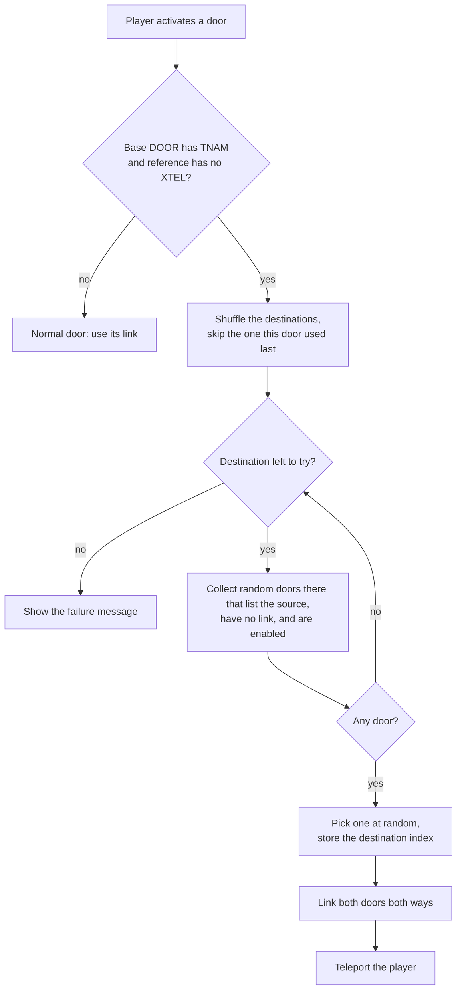

# Random teleport doors

A random door has no fixed destination. The first time it is used, it finds a matching door in
one of its destination cells or worldspaces, links to it, and sends the player there.

OpenSky does not build this yet. It reads the destination list from the record, but nothing uses
it.

## Which doors are random

A door is a random door when its base `DOOR` record has a `TNAM` destination list. There is no
flag. The reference acts as a random door only while it has no `XTEL` teleport link.

## Finding a target door

1. The source location is the activating actor's worldspace, or its interior cell.
2. The door's destinations, cells or worldspaces, are tried in random order, each at most once.
3. In each candidate cell, or in a worldspace's persistent cell, the game collects doors that:
   - are random doors themselves;
   - list the source location among their destinations;
   - have no teleport link yet;
   - are not disabled or deleted.
4. One of them is picked at random.
5. The player remembers which destination index each door used last. That index is skipped in
   favour of another one, and the new index is stored.

When a door is found, the two doors are linked both ways, and the teleport goes ahead. When no
destination gives a door, the game's failure message shows, and the player stays.

## Where the player lands

The player lands at the target door's random teleport marker (`XRTM`) when it has one. Otherwise
the player lands a fixed distance in front of the door, 150 units by default and more for an
automatic door, and faces away from it.
