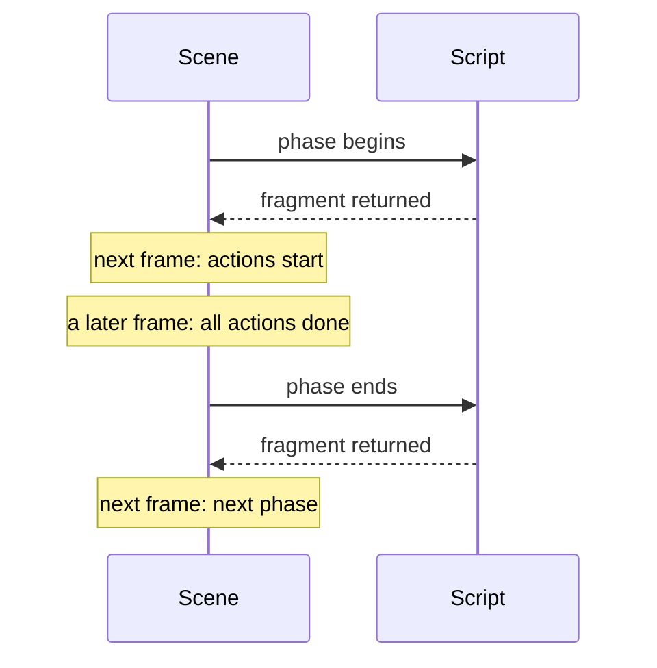
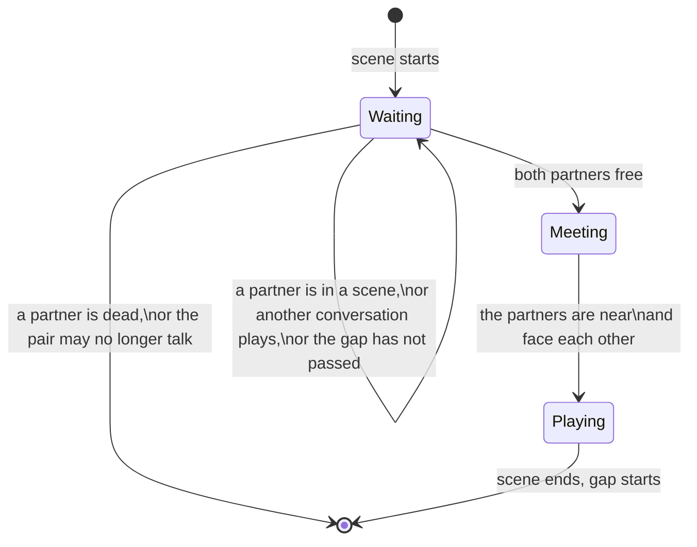
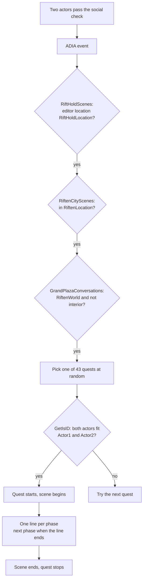

# Scene runtime

A scene is a short script a quest owns: phases run in order, and each phase starts actions
such as a line of dialogue or a wait. The record layout is on the
[scene records](/formats/scenes.md) page. Lines are chosen by the
[dialogue runtime](/engine/dialogue.md), so a scene line follows the same selection rules as
a line in the dialogue menu.

Source for the rules: the Creation Kit wiki, <https://ck.uesp.net/wiki/Category:Scenes>,
"Scene", "Phases", and "Actions". Where the wiki is silent, OpenSky's choice is marked below.

## Starting

A scene starts only while its quest runs. A scene that already plays is left as it is.

Starting runs the begin fragment, then enters phase 1.

## Actors in two scenes

An actor plays in one scene at a time. A scene holds its actors from the moment it enters a
phase until it ends. A second scene that needs a held actor waits before its first phase:

- If the scene that holds the actor has flag 0x10 (interruptible), it is stopped, and the new
  scene takes the actor. A [conversation scene](#conversation-scenes) always counts as
  interruptible.
- Otherwise the new scene waits. It tries again on every tick.
- An optional actor (actor `LNAM` flag 0x02) never makes a scene wait. Its actions are done at
  once while another scene holds it, like an empty alias.

`ForceStart()` stops every playing scene that shares an actor with the new scene, then starts
it. Source: the Creation Kit pages "ForceStart - Scene" and "Scene".

`ObjectReference.GetCurrentScene()` returns the playing scene that holds the reference. A
scene that still waits for the actor does not count, so the read agrees with the one-scene
rule above.

## Actor behaviour flags

Each scene actor has a behaviour `DNAM`. The bits, from xEdit's `wbDefinitionsTES5.pas`:

| Bit | Meaning |
| --- | --- |
| 0x02 | Death ends the scene |
| 0x04 | Combat pauses the scene |
| 0x08 | Combat ends the scene |
| 0x10 | Dialogue with the player pauses the scene |
| 0x20 | Dialogue with the player ends the scene |
| 0x40 | Observing combat pauses the scene |
| 0x80 | Observing combat ends the scene |

Bit 0x01 (death pauses) is unused in the game. The record's `VNAM` holds only the editor's
"set all" choice, so OpenSky reads the actor `DNAM` alone.

On every tick, each actor of a playing scene is checked. An end flag that matches ends the
scene. A pause flag that matches pauses it: no phase moves and no action finishes. When no
pause flag matches any more, the scene resumes, and every running action's start time moves
forward by the length of the pause. So a timer or a line keeps the time it had left.

A dead actor's dialogue or package action is done at once. The game also lets a scene go on
past a dead actor.

An actor of a scene observes combat when it detects a fight that it could watch, as described in
[watching a fight](/engine/random-conversations.md#watching-a-fight). It keeps its scene package,
and bits 0x40 and 0x80 then match. OpenSky does not build watching a fight yet, so these bits
never match.

## Phases

The runtime keeps the current phase, whether it was entered, the running actions, and the
completed actions:

1. A phase is entered when its start conditions pass. Otherwise it is skipped and the next one
   is tried.
2. Entering runs the phase's begin fragments, then starts each action whose start phase is
   this phase.
3. A phase with completion conditions is done when they pass, and only then. A phase with
   none is done when every action whose end phase is this phase has finished. An action with
   no end phase ends in its start phase. For example, phase 2 of `MQ101`'s first scene waits
   for stage 12.
4. Finishing completes the actions that should end by now, runs the phase's end fragments, and
   moves to the next phase.
5. After the last phase, a scene with flag 0x08 (repeat while true) starts again from phase 1
   when its scene conditions pass, with no wait. Otherwise it ends.

The Creation Kit's [Scenes Tab](https://ck.uesp.net/wiki/Scenes_Tab) page gives the phase end as
a choice: "End when all actions are complete" (the default) or "End on conditions". The
[Category:Scenes](https://ck.uesp.net/wiki/Category:Scenes) page says either one ends the phase.
OpenSky follows the choice, for two reasons:

- The data: in `Skyrim.esm`, 1,133 phases have completion conditions and an action that ends
  in them. 738 of those add `IsSceneActionComplete` to the conditions, which would do nothing if
  a finished action already ended the phase.
- The reference game: scenes such as `IvarsteadSSScene` and `MorthalInitialScene` stay in their
  first phase while its condition (`GetVMQuestVariable ::pGo_var`, `GetDistance`) is false,
  although that phase's actions are done at once.

Conditions are checked with the player as subject, no target, and the scene's quest as the
alias quest. Several phases can pass in one tick. A tick takes at most twice as many steps as
the scene has phases, plus four, and repeats a scene at most once, so it cannot loop forever.

The game itself takes several frames for one phase, because each step waits for the one
before it. A fragment adds the time the script needs to return.

One phase with one line of no length takes about 5 to 7 frames this way. A phase whose start
conditions fail is skipped, one phase per frame. OpenSky runs these steps in one tick.

## Actions

| Type | What OpenSky does |
| --- | --- |
| 0, dialogue | The action's alias names the speaker. The topic's responses are selected for that speaker, the winner is marked said, and its result script runs. The action lasts as long as the line. |
| 1, package | The actor in the action's alias runs the action's packages ahead of its own schedule. The action is done when the package reaches its Done state. |
| 2, timer | Lasts the `SNAM` duration in seconds. |

An action whose alias is empty is done at once. The Creation Kit says a scene goes on when an
actor is dead or disabled, and an empty alias is the same case for OpenSky. A dialogue action
whose topic has no passing response for the speaker is also done at once.

The game ends an action at its start in these cases:

| Action | Done at its start when |
| --- | --- |
| Dialogue | The alias is empty, or the speaker is dead, disabled, or deleted |
| Dialogue | The topic is missing, or no response passes for the speaker |
| Package | The alias is empty or not an actor, or the actor is dead, disabled, or deleted |
| Package | None of the action's packages can run for the actor |
| Any | Another scene holds the actor |

Whether the actor is loaded is not part of these tests. An action whose actor the player talks
to in the dialogue menu is skipped for that frame and does not hold its phase.

Before a speaker with a loaded body says its line, it must face the actor it looks at: within
20 degrees, or within 80 degrees while it moves. The line also waits while the speaker still
says something else, or while its body loads.

A dialogue action with flag 0x10000 loops. The Creation Kit says "the actor will loop the dialogue in
this action (within a random time between the specified Min and Max seconds)"
([Scenes Tab](https://ck.uesp.net/wiki/Scenes_Tab)). OpenSky says the line again after a pause drawn
from the action's `DMIN` to `DMAX` range, until the action's end phase ends. A looping line does not
hold its phase: the phase ends when its other actions or its completion conditions say so, and the
loop stops with it.

### Package actions

The Creation Kit says a scene's package overrides every other package of the actor. While a
package action runs, the [package selector](/engine/package-schedules.md#scene-packages) picks
from the action's packages instead of the actor's own list. When the action ends, the actor
goes back to its own list. The runtime asks for the packages again on every tick, so a scene
that a save restored gives them back.

The Creation Kit says: "Package actions are completed when the package reaches the Done
state. Actions with packages that have no Done state can never be completed." So a travel
package is done when the actor arrives. Sandbox, wander, sleep, and eat never end; their
phase needs completion conditions. A procedure that OpenSky cannot run yet counts as done at
once. This is OpenSky's choice, so that a scene with such a package does not wait forever.

[WARNING] A done package action keeps its actor until its end phase ends, or until the scene
ends. The Creation Kit does not say this; it is OpenSky's reading. Without it, an actor who sits
down in an early phase stands up and walks back to its schedule before the scene moves on. In
`MQ101Scene4`, the first prisoner kneels at the block in one phase, and the action holds them
for two more.

### Line length

A line lasts as long as its voice file, as in the game. The file is
`sound\voice\<plugin>\<voice type>\<name>.fuz` ([voice files](/formats/fuz.md)). Its length
is the playing time in the xWMA packet table. The voice type is the speaker's `VTCK`. The
file is read off the main actor, and the line's clock starts when the length is known. So the
next line starts in the tick this one ends: no gap and no overlap.

A response with no voice file lasts the time of its text: `fAIDefaultSpeechMult` (0.15) seconds
per character, kept between `fDialogSpeechDelaySeconds` (2 s) and `fSubtitleSpeechDelay` (8 s). For
example, 30 characters last 4.5 seconds. The window is OpenSky's reading of the two names
([speech timers](/engine/dialogue.md#speech-timers)). A line with no text lasts 3 seconds. A save
loaded while a line waits for its voice file ends that line at once.

## Time

Scene time is game seconds divided by the time scale, so it runs at real speed while the game
clock runs. It stops when the game clock stops, for example in a menu.

## Ending

Each way runs the end fragment. A scene with flag 0x02 (stop quest on end) stops its quest, but only
when it finished on its own.

## Idles

A scene record has no idle fields. Idles come from three places:

- a package action's package plays its own idle list ([package idles](/engine/idle-runtime.md#package-idles));
- a line plays its response's speaker idle (`SNAM`) on the speaker and its listener idle
  (`LNAM`) on the actor it looks at, when the line starts;
- a fragment calls `PlayIdle`.

A line also turns the speaker's head toward its `HTID` alias ([head tracking](/engine/head-tracking.md)).
These idles play without their own conditions, because the author picked them.

[WARNING] When the game starts the speaker and listener idles in a line is not known. OpenSky
starts both with the line.

## Fragments

Scene fragments are in the `VMAD` tail of the `SCEN` ([VMAD](/formats/vmad.md)). Slot 0x01 is
the begin fragment and 0x02 the end fragment. A phase fragment has flag 0x01 for phase begin
and 0x02 for phase end. A fragment with no script runtime to run it is noted as not run in the
trace, not dropped.

## State and saving

A playing scene has a world-state component, `scene`, keyed by the `SCEN`. A scene that is not
playing has no component, so the baseline is "not playing" and costs nothing. Playback writes
the component only when the state changed, because any write to a base record rebuilds the
loaded cells.

A save stores the playing scenes in the `SCNS` chunk, and the pause time of each paused scene
in the `SCNP` chunk ([world chunks](/formats/opensky-save-world-chunks.md)). After a load, a
scene goes on from the same phase with the same running actions, still paused if it was.
The gap after a conversation scene is not saved: after a load, the next conversation scene may
begin at once.

## Scenes far from the player

The game starts a scene whose actors are not loaded, and plays it. This was observed in the
Windows reference game through the bridge plugin's scene readout
([reference game](/tools/reference-game.md)):

- During the opening cart ride, far-away scenes such as `IvarsteadSSScene`,
  `DialogueRiftenSS02Scene`, and `MorthalInitialScene` play while every actor is unloaded. Each
  waits in its first phase on a completion condition, as above.
- `WindhelmIntroScene`, started with `StartScene` from Riverwood, ran its 2.5 s timer and five
  lines with both speakers unloaded, then ended. It did the same after a save made during the
  scene was loaded.

So OpenSky starts and plays such scenes too. Their lines are silent, because the speaker has
no loaded body to speak from.

A line whose speaker has no loaded body ends at once. Read again on 2026-11-04 (1.7.104), with
the bridge's `processLevel` readout: from Riverwood, `WindhelmIntroScene` ran its 2.5 s timer,
then all five lines in about 0.5 s, twice. Both speakers were at process level 3, the lowest.
OpenSky gives such a line no length, so it ends on the next tick.

A far-away [conversation scene](#conversation-scenes) does not play. It waits before its first
phase until both partners have a loaded body. `WindhelmOengulHermirScene3`,
`RiftenGrandPlazaScene30`, `RiftenBeggarSnilfScene`, and `CWDialogueSoldiers02Scene` stayed in
phase 0 for 45 s in the reference game, with enabled actors at process level 3 and no actor in
another scene. Each of their quests has the event `ADIA`. The quests of `WindhelmIntroScene`,
`IvarsteadSSScene`, and `MorthalInitialScene`, which did play, have no event.

## Conversation scenes

A conversation scene is a scene whose quest starts from the actor dialogue event: the `QUST
ENAM` is `ADIA`. `Skyrim.esm` and the DLC have 900 such quests. They hold the short talks
between two townspeople. These scenes follow extra rules:

- The partners are the first two actor aliases of the scene that hold an actor.
- One conversation scene plays at a time in the whole game. When one begins, the game draws a
  gap between `fRandomSceneAgainMinTime` and `fRandomSceneAgainMaxTime` (10 to 30 s in
  `Skyrim.esm`). The gap counts down only while no conversation scene plays, and the next one
  waits until it is over.
- One partner walks to the other before the first phase, and the scene stays paused until
  they are near and face each other
  ([walking together](/engine/random-conversations.md#walking-together)). The walk and the
  phases have no time limit.
- After its last phase, a conversation scene waits 2 seconds before it ends, and holds its
  actors for that time.

While a conversation scene waits for its first phase, the game checks the pair on every update:

1. While the gap is above 0, nothing is checked.
2. A partner that is in a scene sets the gap to 1 second, so the check runs again a second
   later.
3. Else the pair must still be allowed to talk. The speaker has a loaded body, is not the
   player, is not in dialogue, and is within 3000 units of the player. Both packages allow
   conversation (flag 0x02). The partner is not in combat, and is not part way into or out of a
   seat or a bed.
4. When the check fails, the scene stops. A conversation scene stops its quest when it ends
   (`FNAM` flag 0x02), so the quest stops too, and the gap is set to 0.
5. When it passes, one partner starts the walk to the other.

So a scene whose speaker has no loaded body, or is too far from the player, ends at once. A
scene only waits without end when a partner is held by a scene that cannot be interrupted, and
that partner's alias is not optional.

- The scene counts as interruptible, with or without flag 0x10.

The quest starts when two actors fire the event
([random conversations](/engine/random-conversations.md)), and the
[story manager](/engine/story-manager.md) picks it. For the Riften market:

A quest such as `DialogueRiftenGrandPlazaScene11` (priority 30) fills Actor1 and Actor2 from
the event's two actors, each checked with `GetIsID` against its two named people, here Bolli
and Grelka. Its scene has `FNAM` 0x7: it begins when the quest starts, stops the quest when it
ends, and shows all text. Each line sits in its own phase, and the next phase starts when the
line ends. A voiced line gets 0.25 s more. No limit on the number of scenes at once was found
beyond the one-at-a-time rule above.

In OpenSky, a conversation scene whose partners are loaded and free asks the
[social pass](/engine/random-conversations.md#walking-together) to bring them together. The first
partner walks to the second, by the same distances as after an `ADIA` event, and the scene
begins when they stand together. Before each line of any scene, the speaker turns to its
listener: the action's look target, or the other partner of a conversation scene. The line
starts within 20 degrees, or 80 degrees while the speaker walks. The trace of
`openskycli game state scenes` shows "waiting for its partners to meet" and "speaker turns to
the listener".

OpenSky differs in these points:

- It tests and turns the body, where the game tests the head.
- One pair walks together at a time. A pair that has not met after 30 seconds gives its turn to
  another scene and tries again 60 seconds later. A line waits at most 3 seconds for its speaker
  to turn. These times are OpenSky's choices ([unverified values](/engine/unverified-values.md)).
- It starts the gap when the conversation ends.

For example, `RiftenGrandPlazaScene30` starts with its quest at the start of the game. From
Riverwood both speakers are unloaded, so it waits. When the player walks into the Riften
market and both speakers load, the scene begins, if no other conversation plays and the gap
after the last one is over.

## Observed on the install

`Skyrim.esm` has 1,706 scenes the catalog can name. Of the scenes whose actors are all
forced-reference aliases and whose actions are dialogue or timers, 26 were played with no
loaded cell. `DialogueWinterholdInnInitialScene` plays four phases, one line each, between
its two speakers and ends.

## Not done yet

- Observing combat is not known, so the observe-combat behaviour flags never act.
- A conversation partner does not walk to the other partner before the scene begins. The game's
  walk is in [walking together](/engine/random-conversations.md#walking-together).
- A speaker does not wait to face its look target before its line.
- The check on a waiting conversation pair ends the scene when the speaker has no loaded body
  or is in dialogue with the player, or when the partner is in combat. The 3000 units to the
  player, the package flags, and the seat and bed states are not checked there. A partner with
  no loaded body makes the scene wait.
