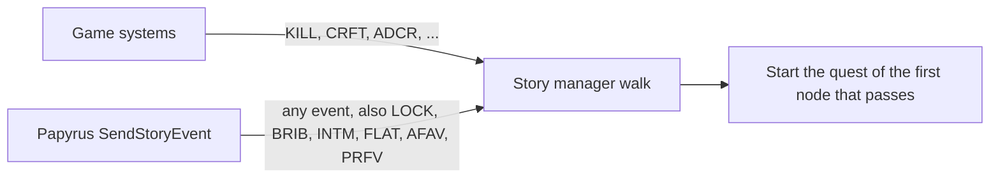

# Story manager

The story manager starts quests when something happens in the game, such as a kill or a
change of location. Each kind of event has a tree of nodes; the record layout is on the
[story manager records](/formats/story-manager.md) page. This page also covers the start-game
pass, which starts the quests listed in the [`.seq` files](/formats/seq.md).

Sources: the Creation Kit wiki, <https://ck.uesp.net/wiki/Story_Manager>, "SM Event Node",
"SM Branch Node", and "SM Quest Node", and xEdit `dev-4.1.6` `wbEventMemberEnum` for the event
data members.

## The walk

An event fires with its four-character code and its data. The walk visits the event nodes
for that code in tree order, and each node's children in sibling order:

1. A node whose conditions fail is skipped with its whole subtree.
2. An event or branch node tries its children in order until one consumes the event.
3. A quest node tries its quests. A quest starts when it is not running, its reset time has
   passed, and its own story-manager conditions (`QUST` after `NEXT`) pass. Starting fills the
   quest's aliases from the event data.
4. A quest node starts one quest, or up to its "number of quests to run" when flag 0x40000 is
   set. With flag 0x10000 (do all before repeating) the quests started least often go first.
5. A quest node that started a quest consumes the event, and the walk stops. With flag 0x20000
   (shares event) it does not, so the walk goes on to the next sibling.
6. Flag 0x01 (random) starts the children or quests at a random position and goes round. The
   position comes from the session's seeded random stream, so a seeded session repeats.

A quest node with a maximum of concurrent quests stops when that many of its quests run.

Conditions are checked with the player as subject and event member `R1` as target. OpenSky
chose these: the wiki does not say what Subject means for a story-manager node, and in the
vanilla trees the conditions that matter use the Event Data run-on.

## Event data

| Member | Meaning |
| --- | --- |
| `R1`, `R2` | Actor 1 and actor 2, references |
| `L1`, `L2` | Location 1 and location 2 |
| `K1` | Keyword |
| `F1` | Form |
| `O1` | Created object, a reference |
| `Q1` | Quest |
| `V1`, `V2` | Value 1 and value 2, numbers |

A condition with run-on type 7 (event data) runs on the reference member its parameter 3
names. `GetEventData` (576) compares a member with a form (`IsID`), reads a value, or tests
the keyword ([conditions](/engine/conditions.md)). Outside a walk, both fail as unresolved.

## Events OpenSky fires

The data of each event comes from its Creation Kit wiki page, such as
<https://ck.uesp.net/wiki/Kill_Actor_Event>. The wiki lists the data in order, not by member.
OpenSky gives the references `R1` and `R2`, the locations `L1`, the forms `F1`, and the numbers
`V1` and `V2`, in the order of the list. The vanilla nodes and quests agree with this: the
`KILL` quests read `V1` and the `KILL` nodes read `V2`, the `AIPL` nodes test the owner in
`R2`, and the `CRFT` quests compare `O1` with item base forms. So the `KILL` mapping below is
confirmed by the data, not only by the list order.

An event that does not set `L1` gets the current location of its `R1`, or of the player
when it has no `R1`.

| Code | When | Data |
| --- | --- | --- |
| `KILL` | An actor dies | `R1` killer, `R2` victim, `L1` victim's location, `V1` crime status, `V2` victim's rank toward the killer |
| `CLOC` | The player's location changes | `R1` player, `L1` old location, `L2` new location |
| `SCPT` | A script calls `Keyword.SendStoryEvent()` | `K1` the keyword, `L1`, `R1`, `R2`, `V1`, `V2` from the call |
| `SKIL` | A player skill gains a level | `R1` player, `V1` the skill's actor-value index |
| `LEVL` | The player gains a level | `R1` player, `V1` the new level |
| `CRFT` | The player crafts an item | `R1` player, `R2` workbench, `O1` the created base object |
| `ASSU` | An assault is reported | `R1` attacker, `R2` victim |
| `ADCR` | A crime costs crime gold | `R1` criminal, `R2` victim, `F1` crime faction, `V1` gold, `V2` crime type |
| `ARRT` | The player accepts an arrest | `R1` guard, `R2` player, `V1` crime type |
| `JAIL` | The arrest sends the player to jail | `R1` guard, `F1` crime faction, `V1` bounty |
| `ESJA` | The player leaves the jail cell without serving | `R1` player, `F1` crime faction |
| `STIJ` | The player serves a sentence | `F1` crime faction, `V1` bounty, `V2` days |
| `CAST` | The player casts a spell | `R1` player, `R2` aimed target, `F1` spell |
| `AIPL` | The player takes, steals, pickpockets, or buys an item | `R1` source container, `R2` owner, `F1` item, `V1` acquire type |
| `REMP` | The player drops, stores, or sells an item | `R1` container, `R2` owner, `F1` item, `V1` remove type |
| `CHRR` | A script changes a relationship rank | `R1`, `R2` the actors, `V1` old rank, `V2` new rank |
| `ADIA` | Two actors start a conversation | `R1` the speaker, `R2` the listener |
| `AHEL` | An actor says hello in passing | `R1` the walker, `R2` the actor greeted |
| `DEAD` | An actor finds a dead body | `R1` the finder, `R2` the body |
| `NVPE` | The player gets a shout it did not know, or any actor learns a voice power | `R1` the actor, `F1` the shout or voice power |
| `INFC` | Any actor gets a disease it did not have | `R1` the actor, `F1` the disease |
| `CURE` | A disease is removed from any actor | `R1` the actor, `F1` the disease |
| `PFIN` | The player pays a fine | `R1` player, `R2` the guard who confronted the player, `F1` crime faction, `V1` bounty |
| `TRES` | The player enters a cell they may not be in, or a witness reports a trespass | `R1` the witness or none, `R2` player, `V1` the crime gold, 0 on entry |
| `QSTR` | A script starts a stopped quest with `Start()` or `SetStage()` | `Q1` the quest |

`KILL` crime status is 0 (not murder), 1 (murder), or 2 (murder that cost crime gold). A death
is murder when the player struck the victim first ([crime](/engine/crime.md)). The rank is the
victim's rank toward the killer, 0 when no relationship names the pair. The crime type is 0
steal, 1 pickpocket, 2 trespass, 3 assault, 4 murder, 5 escape from jail, 6 werewolf. The
acquire type is 1 steal, 2 buy, 3 pickpocket, 4 pick up, 5 container, 6 dead body. The remove type
is 4
dropped, 5 given (sold), 6 put in a container.

`ADIA`, `AHEL`, and `DEAD` come from the [social pass](/engine/random-conversations.md).
`TRES` leaves `L1` unset, so it gets the location of the witness, or of the player on entry.
`QSTR` walks no event node; the quest has already started in the script call.

`SKIL` fires once when one use raises a skill by more than one level, as the wiki says. `CLOC` is
checked every 30 frames.

`SendStoryEventAndWait()` returns at once with the result, because the walk is synchronous.

`PFIN`, `INFC`, `CURE`, and `QSTR` have no node in `Skyrim.esm`, so they start nothing there;
they fire for mods. `STIJ` (served time) has no vanilla node either, but it fires when a
sentence is served ([jail](/engine/jail.md)). `AFAV`, `LOCK`, `BRIB`, `INTM`, `FLAT`, and `PRFV`
reach a quest only from a script, as in the game.

### Which events the game sends

The game itself sends these events, each from the system named:

| Code | Sent from |
| --- | --- |
| `KILL` | An actor's death. A murder crime is made in the same step |
| `ASSU` | An assault |
| `CLOC` | An actor's location change |
| `SCPT` | `SendStoryEvent` and `SendStoryEventAndWait`, which fail with an error before the start-up quests are set up |
| `ADIA` | Dialogue, including a conversation one NPC starts with another |
| `AHEL` | A new head-tracking target ([hellos in passing](/engine/random-conversations.md#hellos-in-passing-ahel)) |
| `AIPL`, `REMP` | An item added to or removed from the player |
| `CRFT` | Alchemy, enchanting, and smithing, both making and improving |
| `INFC`, `CURE` | A disease added to or removed from any actor, the player or not. `INFC` only when the actor did not have it and did not resist it ([diseases](/engine/diseases.md)). Data: `R1` the actor, `F1` the disease |
| `NVPE` | The player gets a shout it did not know, or any actor gets a voice power spell. Data: `R1` the actor, `F1` the shout or voice power |
| `DEAD` | An actor reacts to a body it detects ([finding a body](/engine/random-conversations.md#finding-a-body-dead)) |
| `SKIL`, `LEVL` | A skill level, and a player level |
| `CHRR` | A relationship rank change, by a script or by the game |
| `PFIN` | The player pays a fine, before the gold is taken and the bounty cleared. Data: `R1` the player, `R2` the guard in the conversation, `F1` the crime faction, `V1` the bounty |
| `JAIL`, `STIJ`, `ESJA` | Going to jail, serving time, and escaping |
| `TRES` | A trespass, in two ways below |
| `ADCR` | A crime when it becomes final ([crime reports](/engine/crime-reports.md)) |
| `ARRT` | An arrest |
| `CAST` | A spell cast |
| `QSTR` | A quest start that is not immediate, below. Data: `Q1` the quest |

The game never sends `AFAV`, `LOCK`, `INTM`, `BRIB`, `FLAT`, or `PRFV`. These reach a quest only
through `SendStoryEvent` from a script.

`TRES` comes from two places:

- The player enters a cell they may not be in. A trespass crime is made, and `TRES` fires once
  for that entry, with no victim: `R2` the player, `L1` the cell's location, `V1` 0.
- A witness or an owner reports a trespass: from a door or an activator the player uses, or from
  a trespass package. Data: `R1` the witness, `R2` the player, `L1` the player's location, `V1`
  the crime value.

`QSTR` is the story manager's own way to start a quest later. The start goes into the story
manager's queue, and when the queue reaches it, the quest starts at once, without a walk of the
event nodes. The queue spreads its work over frames. What the script sees while it waits, and
what each call answers, is on the [quest state](/engine/quest-state.md#starting-a-quest) page.
These starts go through `QSTR`:

- `Quest.Start()` from a script. It is latent: the script waits for the start. An event-scoped
  quest refuses it with the error "attempting to start event scoped quest outside of story
  manager".
- `SetStage()` on a quest that is stopped. The log says the quest "will be started first".
- Showing an objective of a quest that is stopped.

Console starts, perk quest entries, the character creation quest at a new game, the restart of
running quests after a load, and starts by the story manager walk itself start the quest directly
and send no `QSTR`.

At a new game, before the player is placed, the game walks every quest once in load order. Each
quest with `QUST DNAM` flag 0x0010 (Start Game Enabled) starts directly: its aliases fill, and it
runs. No `QSTR` is sent and no event node is walked. All 329 such quests of `Skyrim.esm` have
flags 0x0011. After a load, the same walk starts the flagged quests that have no saved state and
are not running, such as quests a new plugin adds.

OpenSky sends the same events from play. It differs in how `QSTR` starts a quest: the game
queues the start and runs it on a later frame, and OpenSky starts the quest inside the script
call, then sends `QSTR` only for the record and for mods.

## Papyrus events for a started quest

When an event node starts a quest, the quest's scripts attach first. Then each script hears
the matching `OnStory` event, with the event data as its arguments. The order follows the
Creation Kit wiki page for each event.

| Code | Papyrus event | Arguments |
| --- | --- | --- |
| `KILL` | `OnStoryKillActor` | `R2` victim, `R1` killer, `L1`, `V1` crime status, `V2` relationship rank |
| `CLOC` | `OnStoryChangeLocation` | `R1`, `L1` old, `L2` new |
| `AIPL` | `OnStoryAddToPlayer` | `R2` owner, `R1` container, `L1`, `F1` item, `V1` acquire type |
| `ASSU` | `OnStoryAssaultActor` | `R2` victim, `R1` attacker, `L1`, `V1` crime |
| `ADCR` | `OnStoryCrimeGold` | `R2` victim, `R1` criminal, `F1` faction, `V1` gold, `V2` crime type |
| `SKIL` | `OnStoryIncreaseSkill` | the skill name as a string |
| `SCPT` | `OnStoryScript` | `K1`, `L1`, `R1`, `R2`, `V1`, `V2` |

The skill name drops spaces and hyphens, as in `OneHanded`. Archery is sent as `Marksman`
and Speech as `Speechcraft`, the names `Actor.GetActorValue` uses. The wiki does not
confirm this spelling. Other codes send no event.

## Start-game pass

When a world loads, OpenSky reads the `.seq` file of each active plugin and starts every
listed quest that has no runtime state yet. A quest that a save already holds keeps its saved
state. Quests start first; then scripts attach once; then each quest runs its start-up stage
and starts its begin-on-start scenes. That order lets a start-up stage fragment see the other
start-game quests running.

The quest store, the scene index, and the story-manager index read every active plugin. On
the install the pass starts 436 quests: 330 from `Skyrim.esm` and the rest from `Update.esm`,
the three DLC, and the two free Creation Club plugins.

## State and saving

The story manager keeps, per quest it started, the time of the last start and a count. The
reset time and "do all before repeating" read them. The world-state component is
`storyManager`, keyed by the `QUST`, and a save stores it in the `SMQS` chunk
([world chunks](/formats/opensky-save-world-chunks.md)).

## Observed on the install

`Skyrim.esm` has event nodes for 24 codes: `ADCR`, `ADIA`, `AFAV`, `AHEL`, `AIPL`, `ARRT`, `ASSU`,
`BRIB`, `CAST`, `CHRR`, `CLOC`, `CRFT`, `DEAD`, `ESJA`, `FLAT`, `INTM`, `JAIL`, `KILL`, `LEVL`,
`LOCK`, `NVPE`, `REMP`, `SCPT`, and `SKIL`. Firing `ESJA` (escape jail) with the player as `R1`
starts `EscapeJailAchievementQuest` and `EscapeJailQuest`, with no condition failing. `SKIL` starts
`WISkillIncrease02`.

## Not done yet

- The `QSTR` queue, above.
- `AIPL` and `REMP` name the owner in `R2` only for a pickpocket, a trade, and a container an
  actor owns. An item picked up from the world, and a faction's container, name no owner.
  Eating and items a script moves fire neither event.
- `ARRT` names the kind of the faction's last crime that cost gold. The bounty does not record
  which crimes it is for, and a load forgets the kind, so it reads steal then.
