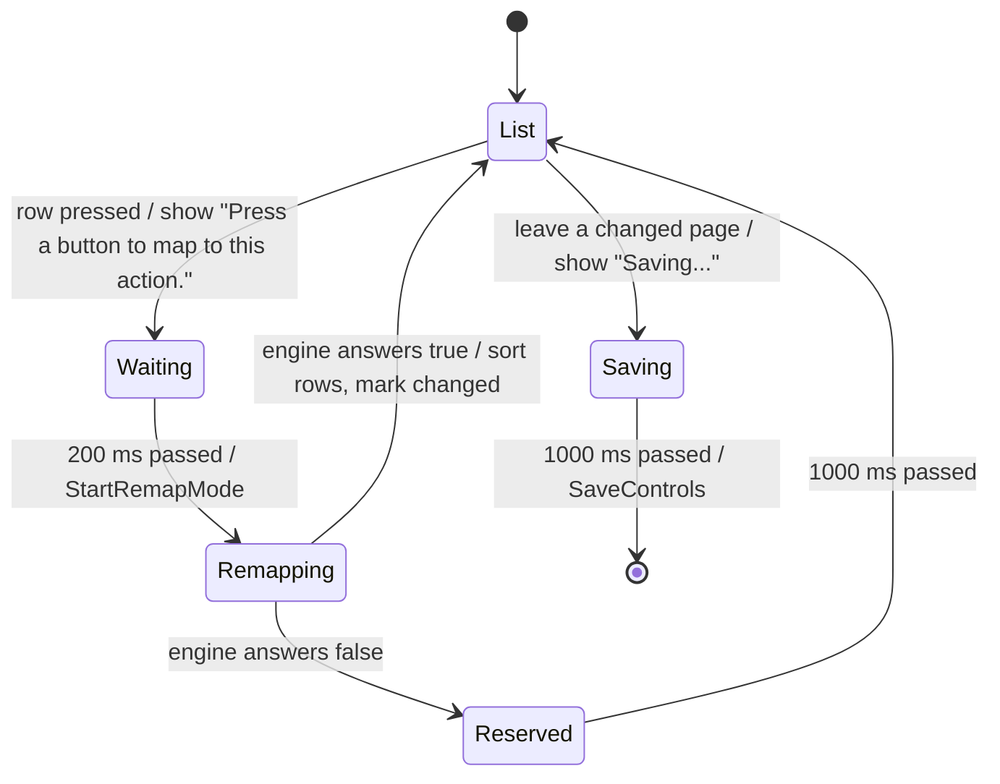
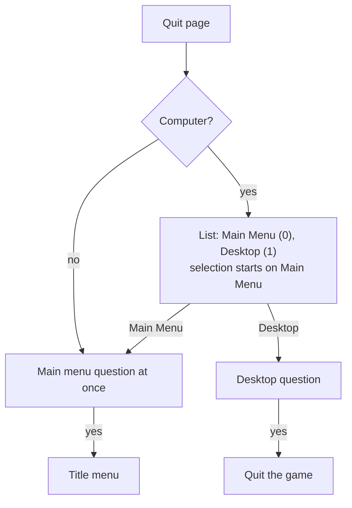

# System menu

The system menu is the pause menu: Resume, Quicksave, Save, Load, Installed Content, Settings,
Controls, Help, and Quit, the rows of the vanilla System page. It was the first real consumer of
[menu mode](/engine/menu-mode.md) input. It can also show itself through the vanilla
`Interface\quest_journal.swf` movie.

The menu works with no install, no renderer, and no movie. Only the movie layer needs them.

## Selector

The selector is a plain value: the rows, the highlighted row, the last result, and the open
page. It knows nothing about the renderer, the movie, or AppKit.

Activating a row returns a result instead of doing the action:

| Row | Result | Who acts |
| --- | --- | --- |
| Resume | resume | The selector closes; the host closes the menu |
| Quicksave | quicksave | The host writes the `Quicksave` slot; the menu stays open |
| Every other row | show page | The page model takes the keys |

Each page is its own model: the Settings page steps the [player settings](/engine/settings.md),
the Save and Load pages list saves newest first and ask before an overwrite or a delete, the
Controls page waits for the next key and rebinds it ([control map](/formats/controlmap.md)),
Help and Installed Content list topics and show the text of one, and Quit asks Main Menu,
Desktop, or Cancel, with Cancel selected. Main Menu opens the [title menu](/engine/main-menu.md).
Cancel on a page returns to the row list.

Up and down wrap around, as the vanilla list does.
Left and right are accepted and ignored, so they count as handled and do not reach the world.
Cancel means Resume, because the vanilla pause menu closes on the key that opened it.

## Pausing the world

Opening the menu pushes `SystemMenu` onto the menu stack, and makes the game view the input
consumer. That push is what pauses the world. The menu does not own the pause. It gets it by being
on the stack.

The control map's Pause key, Esc, opens the menu. While the mouse is captured, the first Esc
releases it instead. Opening it may write a pause autosave. `J` opens the [quest
journal](/engine/journal.md).

## Settings

- Game data folder: shown, not changed here. Change it in the Settings window (Cmd+,).
- Master volume: the value in the player settings store, which the audio engine follows.

## The vanilla movie

`startmenu.swf` is the title screen, not the pause menu. Its rows are Continue, New, Load,
Creations, Mods, Credits, Quit, and Help, and it has no `$SETTINGS` string. It is still useful for
testing the [ActionScript runtime](/engine/as2-runtime.md).

The pause menu is `quest_journal.swf`. Its `QuestJournalBase` has three pages: Quests, General
Stats, and System. The [quest journal](/engine/journal.md) drives the Quests page with the same
movie and setup, so the two menus cannot be open at once. The System page is `PageArray[2]`, and
the movie builds its own rows:

`$QUICKSAVE`, `$SAVE`, `$LOAD`, `$INSTALLED CONTENT`, `$SETTINGS`, `$CONTROLS`, `$HELP`, `$QUIT`.

Settings opens the movie's own panel with `$Gameplay`, `$Display`, and `$Audio`. Quit shows
`$Main Menu` and `$Desktop`. The game resolves each token through the
[translation map](/formats/translation-strings.md). The pages and transitions are the movie's own.

Start-up order:

1. Before `start()`, install the handlers the movie calls out to: trace, sound, feature queries,
   and player info.
2. Call `SetPlatform(0)`, `InitExtensions`, `ShowMenu`, and `SwitchPageToFront(2, true)`.
3. The game normally sets `TopmostPage`, `iCurrentTab`, and focus through tab buttons backed by
   game data. OpenSky sets the System page and index directly, calls the page's `startPage`, and
   focuses its list. The tab group's `onTabChange` is what calls `startPage` in the game, and
   `startPage` adds the list's `itemPress` listener. Without it, accept on a row does nothing.

The other two pages fade to `hide`. System stops at its `forceFade` label.

Menu events become Flash key down and key up events. Cancel becomes Tab, not Escape:
`SystemPage.handleInput` goes back a page on `NavigationCode.TAB` and ignores `ESCAPE`, as the
vanilla inventory menus do. The Settings row opens
`SystemPage.SETTINGS_CATEGORY_STATE` by its named constant, through `StartState(aiState)`. No state
number is written into OpenSky. The movie's `CloseMenu` call closes the engine menu. If the movie
is missing or refuses the input, the engine selector handles it.

Input must go through the renderer's SWF update batch. That batch rebuilds the draw commands before
it returns. Sending input to the runtime directly changes the movie's selection without redrawing.

The renderer has one SWF layer. The system menu takes it from the HUD while the movie is up, and
gives it back on Resume. The movie is on by default, so play mode shows the menu as the game does.

No movie problem throws out of a control.

## The movie's own pages

With the movie up, the Save, Load, Controls, and Quit pages are the movie's own. Each row press
calls the engine, and the engine answers with data, as the game does. Calls measured with
`openskycli menu system` and read from the movie's `SystemPage` class:

| Movie calls | Engine answer |
| --- | --- |
| `SAVE` or `LOAD` with the list and a batch size | Fills the `SaveLoadPanel` list, newest first, then `onSaveLoadBatchComplete`. Saving adds a `[NEW SAVE]` row at the top |
| `SaveGame`, `LoadGame`, `DeleteSave` with a row | Writes, loads, or deletes that save. When saving, row 0 is a new save |
| `ShowScreenshot` | Puts the save's `THMB` picture in the movie's image slot, then `ScreenshotReady` |
| `RequestInputMappings` with the list | One entry per remappable gameplay event: its text, its key art, the key code, and a sort index |
| `StartRemapMode` with an event | The engine waits for the next key, rebinds it, and calls `FinishRemapMode(true)`; a reserved key gives `false` |
| `ResetControlsToDefaults` | Restores the default bindings and fills the list again |
| `QuitToMainMenu`, `QuitToDesktop` | Opens the title menu, or quits |

A mapping entry's key art is the key's name in `interface\controls\pc\keyboard_english.txt`, such as
`L-Ctrl` or `Mouse1` ([control map](/formats/controlmap.md), "Key names"). The movie draws the
button with that name. The X key deletes a save and T lists the characters, as in the movie's own
key handler.

The save and load pages, their questions, and the progress line read string settings:
`sMenuDisplayNewSave` names the new-save row, `sSaveOverSaveGame` and `sDeleteSaveGame` ask before
overwriting or deleting, and `sQuickSaving`, `sSaveSuccessful`, `sLoading`, `sDeleteSuccessful`, and
`sSaveFailed` fill the progress line. A save's title is its slot and the character's name, or
`sDefaultPlayerName` when it has none. An autosave slot reads `sAutosaveAbbrev` and its number, and
the quicksave slot `sQuicksaveAbbrev`. The detail line follows the game's save description:
`<sLevelAbbrev> <level>: <location>, <sPlayTime>: <time>`. The location uses `sDefaultCellName`
for an exterior cell and `sMenuDisplayUnknownLocationString` when there is no cell. Without game
data, the pages keep OpenSky's English words.

The Settings page keeps its values in the [player settings](/engine/settings.md). The engine
fills each category's rows when the movie asks for them. Each row carries `text`, `movieType`,
`value`, `ID` (its index in the category), and `defaultVal`. A row that the movie changes itself
calls `OptionChange([ID, value])`, and the engine writes that value to the store. A click on a
stepper arrow, a slider, or a check box does this. So does the movie's `$Defaults` button, which
sets each row to its `defaultVal`.

### Settings rows and saving

The movie fixes each page's rows and their kind: 0 is a slider, 1 a stepper, and 2 a check
box. The Gameplay page, for example, has a Save on Pause stepper (Disabled to 5 Mins), a
Difficulty stepper (Legendary down to Very Easy), and a Look Sensitivity slider. Under the
cursor the row finds the part on top:

- Slider: the thumb, the two arrows, and the track react to press and release.
- Stepper: the two arrows react to press and release. A click on the value acts as the next
  arrow.
- Check box: toggles on release.

Each change calls `OptionChange(ID, value)` and plays `UIMenuPrevNext`. A slider's value is its
scroll position divided by 20, so 0 to 1. A stepper's value is the chosen index, and a check
box's is 0 or 1. When the player leaves a changed page, the movie shows `$Saving...` and,
1000 ms later, calls `SaveSettings`, or `SaveControls` for the Controls page.

### Controls rows and remapping

The movie asks for the rows with `RequestInputMappings` and the chosen category, then sorts them
by each row's sort index. Only the Switch titles are fixed in the movie. While it waits, the
list takes no selection. A failure shows `$That button is reserved.`

The sort and the draw, `MappingList.InvalidateData`, run in the same script as the request,
and the movie asks only while its list is empty. So the engine fills the list during the call.
An answer after the call would land in a list the movie has already drawn empty. `MappingList`
is the `List_mc` clip inside `InputMappingPanel`; the panel itself has no `InvalidateData`.
After a reset the engine redraws `InputMappingPanel/List_mc` itself.

The game keeps changed bindings in a custom control map file beside the default
`Interface/Controls/PC/ControlMap.txt`, so they last after a restart.

### Quit

Both questions show inside the movie: `$Quit to main menu?  Any unsaved progress will be
lost.` and `$Quit to desktop?  Any unsaved progress will be lost.`

### Where OpenSky differs

Seen beside the game:

- [WARNING] A mouse click on a check box, a stepper arrow, or a slider changes nothing. The
  Settings page also draws over its category list, and after Esc the old list stays on screen
  while the selection is stuck.
- [WARNING] The Quit list stays on Cancel and cannot be moved.

## The cursor

The pause menu shows the cursor, as in the game. Each click and each move goes to the movie, so
the rows, the sliders, the steppers, the check boxes, and the Controls list take clicks and drags.
Without the movie, a click is the accept button.

## Help and Installed Content

The movie builds both rows itself. `SystemPage.onCategoryButtonPress` maps a row to a case of
its switch, so the row index is not the case number. Without the `$CREATIONS` row
(`SetShowMod(false)`), every row from `MOD_MANAGER_BUTTON_INDEX` (4) on moves up one case.
`$INSTALLED CONTENT` is row 3 and `$HELP` is row 6.

| Row | Movie calls | Then |
| --- | --- | --- |
| Installed Content | `PopulateCreationClubTopics([entryList])` | Sorts the list, then `CREATIONS_LIST_STATE` (11) if it has rows |
| Help | `PopulateHelpTopics([entryList])` | Sorts the list, then `HELP_LIST_STATE` (13) if it has rows |
| A topic | `RequestCreationClubText` or `RequestHelpText([entry.index, titleField, textField])` | `CREATIONS_TEXT_STATE` (12) or `HELP_TEXT_STATE` (14) |

The movie checks the list length right after the populate call, so the engine fills the list
inside the call, not after the event as it does for the save calls. Each entry has `text` and
`index`; the movie hands `index` back when a topic is pressed. The engine writes the title and
the text into the two fields it passes. The text field is a component, so the engine writes
its `textField`. The movie then turns each `[Event]` tag into key art: its `CreateButtonArt` calls
`GetButtonFromUserEvent` with the controlmap user event, and the engine answers with the bound
key's name. Without that answer the movie faults before it shows the text.

The movie then calls `flash.display.BitmapData.loadBitmap` with that name and `.png`, such as
`E.png`. The movie exports one bitmap per key under that name. When the bitmap has a size, the
movie writes `` into the `htmlText`, and the field draws
the picture in the line of text. With a gamepad connected, the answer is the gamepad art name,
such as `360_A`. An event the player cannot remap, such as a camera event, answers with its
first input in `controlmap.txt`.

Help lists the `HelpManualPC` form list, which the `HMPC` default object names
([UESP DOBJ](https://en.uesp.net/wiki/Skyrim_Mod:Mod_File_Format/DOBJ)). Each entry is a
`MESG`: its `FULL` is the title and its `DESC` the text.

Installed Content works the same way with the `HelpManualInstalledContent` form list in
`Update.esm`, which the `HMCC` default object names. It holds seven messages, such as
`Help_ccBGSSSE001` ("Fishing") and `Help_ccQDRSSE001` ("Survival Mode"). The game shows every
entry, whether or not its plugin is installed, and a plugin with no entry does not appear. In
the text, each carriage return shows as a space. A mod changes the list only by overriding the
form list or its messages.

A second list, `HelpManualInstalledContentAE` (77 messages, `HMAE`), is used when a check in
the game passes, likely that the player owns the Anniversary Edition upgrade. OpenSky always uses
the shorter list ([unverified values](/engine/unverified-values.md)).

A clean-room read of `SkyrimSE.exe`, 2026-11-15, found that the engine fills the list from one
of these two default objects, and that it reads no other file for it. The Creations download
menu keeps a separate `ContentCatalog.txt`, which this list does not use. The default object
tags were read from `Update.esm` on the install.

## Not done yet

- `PrepSaveGameScreenshot` is answered without a fresh picture of the current frame.
