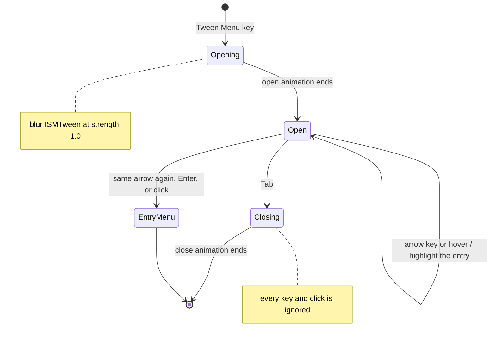

# Tween menu

The Tween Menu key (Tab) opens the Tween menu over the paused world. It has four entries:
Skills at the top, Magic on the left, Items on the right, and Map at the bottom. Choosing an
entry shuts the Tween menu and opens that menu, as its own key does: the
[skills menu](/engine/skills-menu.md), the magic menu, the
[inventory menu](/engine/inventory-menu.md), or the map. Tab or Esc shuts it again. In
follower command mode, Tab only leaves that mode ([follower commands](/engine/follower-commands.md)).

A bar along the bottom shows the date line, the player's level, and how far the player is
toward the next level. While a level waits to be applied, the Skills entry reads "LEVEL UP".

`openskycli game input press tweenMenu` opens the menu as Tab does, and `state menu` reads
`tween`: the highlighted entry, `levelUp`, and whether the close animation runs.

## The movie

`Interface\tweenmenu.swf` owns the four entries, their highlight, the arrow keys, the mouse,
and the open and close animations. Read from the movie's compiled actions in the install, the
engine calls the root `InitExtensions` and then these `GameDelegate` callbacks:

| Call | Arguments |
| --- | --- |
| `ShowMenu` | none; shows the menu and the bottom bar |
| `StartOpenMenuAnim` | whether a level waits, the date line, the level as text, the level progress from 0 to 100 |
| `StartCloseMenuAnim` | none; plays the close animation |

The movie calls the engine back:

| Call | When |
| --- | --- |
| `HighlightMenu(n)` | the arrow keys or the mouse move the highlight |
| `OpenHighlightedMenu(n)` | Enter or a click chooses an entry |
| `OpenAnimFinished` | the open animation ends |
| `StartCloseMenu` | Tab starts the close animation |
| `CloseMenu` | the close animation ends |

The entry number `n` is 1 for Skills, 2 for Magic, 3 for Items, and 4 for Map. The movie
also has `HideMenu` and `ResetStatsButton`; OpenSky does not call them.

Esc reaches the engine, not the movie. OpenSky answers it as the movie answers Tab: it plays
the close animation and shuts the menu when the movie calls `CloseMenu`.

The game's menu:

In the movie, the first press of an arrow key highlights the entry that sits that way, and a
second press of the same key opens it. Enter opens the highlighted entry. Hovering the mouse
over an entry highlights it. A click opens the entry under the cursor, unless something else is
on top of it or the close animation runs. Once the close animation starts, the movie ignores
all input. While a level waits, `StartOpenMenuAnim` gets `true` as its first argument, and the
movie writes `$LEVEL UP` into the Skills entry; the engine can set it back to `$SKILLS`. A
werewolf cannot open the menu and sees `sTweenDisabledMessage` ("Character screen not
available to werewolves.").

Without the movie, OpenSky draws a text panel: the arrow keys pick the entry that sits that
way, and Enter opens it.

## Blur

The world behind the menu is blurred by an image space modifier. The engine takes the
"ImageSpaceModifier for inventory menu" default object (`IMID`), which is `ISMTween`
(`000434BB`) in `Skyrim.esm`, and applies it at strength 1.0 when the menu opens. The inventory,
magic, and other menus use the same modifier, so it is counted: it goes away only when the
last menu that uses it closes.

| `ISMTween` value | Time 0 | Time 1 |
| --- | --- | --- |
| Depth of field strength | 1 | 0 |
| Depth of field distance and range | 128, 768 | 128, 768 |
| Radial blur strength | 0.1 | 0 |
| Radial blur ramp up and start | 0.2, 0.2 | 0.2, 0.2 |
| Saturation add | −0.15 | 0 |

Its duration is 1.0 s and its animated flag is off, and every multiply factor is 1. A modifier
that is not animated most likely holds its time-0 values for as long as it is applied, with no
fade ([image space](/rendering/image-space.md)).

## Where OpenSky differs

Seen beside the game:

- [WARNING] Tab does not close the menu; only Esc does.
- [WARNING] A mouse click on an entry opens nothing.
- [WARNING] The world behind the menu is not blurred.
- [WARNING] With a level waiting, the entry still reads SKILLS.

## Camera

While the menu is open, the camera widens its view and turns a little toward the
highlighted entry. A clean-room read of `SkyrimSE.exe`, 2026-11-15, found:

- On open, the horizontal field of view grows by 10 degrees at a fixed 25 degrees a second,
  so it takes 0.4 seconds.
- A highlighted entry sets a turn target of 0.05 radians (about 2.9 degrees). Each frame the
  turn moves a share of the gap to its target: 4 times the frame time while open, 10 times
  while closing. A share of 1 or more lands on the target.
- On close, the turn and the field of view go back to 0 at the same rates. The move ends
  when the field of view is back, so it can end after the menu has shut.
- The camera does not move closer to the player.

The read did not say which entry turns which way. OpenSky turns toward where the entry sits:
up for Skills, left for Magic, right for Items, and down for Map
([unverified values](/engine/unverified-values.md)).
