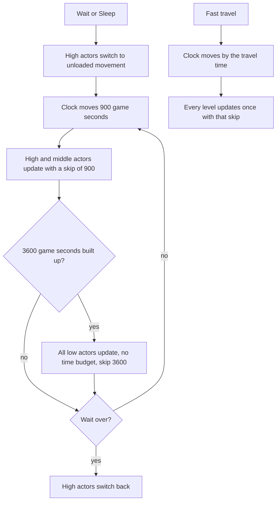
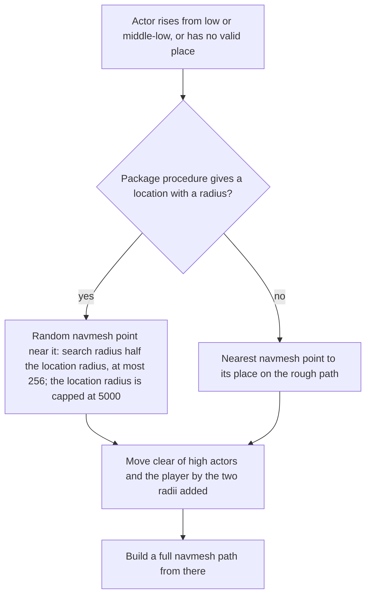

# Actors outside the loaded area

A town resident is placed by the editor inside a house, but by day the game shows them outside, at
work or in the market. Their packages ([package schedules](/engine/package-schedules.md)) keep
running when the player is far away. This page describes how the game keeps them on schedule.
A process level is how much work the game spends on one actor.

## Process levels

Every actor with AI is in one of four levels. The level is worked out again from a queue once per
frame. It does not change while Wait, Sleep, or a fast travel runs.

| Level | Which actors | Update |
| --- | --- | --- |
| High | Has 3D, and its cell is attached: inside the active grid, or the player's interior | Every frame |
| Middle-high | Has 3D, and its cell is loaded but not attached (in the cell buffer) | 0.05 / timescale game hours |
| Middle-low | In a world's persistent cell and over 40960 units from the player, or its cell is in memory but it has no 3D | 0.15 / timescale game hours |
| Low | Its cell is not loaded | 0.3 / timescale game hours |

At the default timescale of 20, the three intervals are 9, 27, and 54 game seconds, or 0.45,
1.35, and 2.7 real seconds. A game setting controls the 40960, as 10 cells of 4096 units.
Persistent actors in unloaded cells stay at the low level, with no distance limit. When the clock
went backwards, such as at midnight, the actor updates at once.

The middle and low lists are walked in turn, each resuming where it stopped. They share a time
budget per frame, checked every 10 actors: 5 ms at 30 frames per second or more, 0.5 ms below 10,
and (0.5 + 5) × fps / 40 ms between. Low actors are also spread over worker threads.

One update covers (now − last update hour) × 3600 / timescale real seconds. An actor's first
update only notes the time; it does not catch up.

## Choosing a package while unloaded

Each low or middle update runs the same package choice as for a loaded actor. The package is
picked again every 15 s, but an unloaded actor checks this only when it updates, so in effect
every 15 s rounded up to its next update.

## Moving while unloaded

The path of an unloaded actor runs over the navmesh info graph: one node per navmesh, linked by
doors. The game builds it even while those navmeshes are not loaded. A path can finish on a later
frame than it was asked for.

Each update moves the actor along the path by its package's speed (walk, run) times the elapsed
time. It stops at the goal minus the goal's radius. The actor is set to each path point it passes,
and on the last part it is placed on the straight line between two points, facing along the path.
So it slides along the path; it does not jump from point to point. A path point at a load door
takes the actor through the door, into the cell behind it.

Worked example, with an assumed walk speed: if a resident walks at 80 units per second and updates
at the low level, every 2.7 real seconds, each update moves them 216 units along the path. A
1000-unit walk from the house door to the forge then takes 5 updates.

## Time skips

A game setting controls the 900. The fast travel time, in real seconds, is the path length divided
by the player's speed, times a factor of 1.0 that a game setting controls. A flying mount uses its
own speed, 7000 by default.

What a skip does to one actor:

- Movement uses the clock difference, so the actor walks its path for the whole skipped time.
- A low actor with a skip over 900 is first placed straight at its package's location, then picks
  its package as usual. In Wait the skip is in game seconds, so the hourly batch of 3600 always
  places them. In fast travel it is in real seconds, so only a trip over 900 real seconds does.
- A high or middle actor runs its current procedure and is told that time was skipped.

## Arriving in the loaded area

No new walk starts from the package's start point.

While loaded, an actor more than 2048 units from the player, or 4096 when it is in view, moves by
snapping along the navmesh instead of by physics.

## New game, enabling, and saves

At a new game, every actor other than the player goes into a placement queue. For each persistent,
living actor in it, the game picks the first package whose conditions pass at the current hour, and
places the actor at that package's location: the target reference, the cell, or the procedure's
location. The actor is put into that cell and worldspace. When the location radius is over 200 units
(a game setting), a random point inside it is chosen.

So a new game started in Riverwood at midday shows the blacksmith at his forge at once, not in his
house.

An actor enabled from an initially disabled state is also placed straight at its package location.

A save stores each actor's place and its last update hour. Loading it keeps both, and does not pick
places again by the hour.

## In OpenSky

OpenSky runs the low level only. Every 0.3 / timescale game hours, 54 game seconds at the default,
a pass starts over each persistent placed actor that no loaded cell holds. The pass places the
actors in turn inside the frame budget ([AI process levels](/engine/ai-process-levels.md#in-opensky)):

1. It picks the actor's package by the same rules as for a loaded actor.
2. It finds the place of the package's first input that names one: a location (a reference,
   the editor place, or the editor cell), or a target that is one reference, such as the seat
   of a sit package. An input it cannot place, such as an alias, keeps the actor where it is.
3. An actor already in that cell and inside the location radius stays.
4. When the place is in a loaded cell and the actor is in an interior, the actor comes out of
   the loaded door that leads into its interior. The loaded package then walks it to the place.
5. Otherwise the actor is put straight at the place.

The pass covers every persistent placed actor, also when several actors share one base, as
the city guards do. A dead or disabled actor does not move. A moved actor keeps the worldspace
of its new cell, because a city world and Tamriel share grid coordinates.

A new game runs steps 1, 2, 3, and 5 once for every such actor, one in a loaded cell too. Step 4
is left out, so no actor walks out of a door at the start. The placement runs at the first
update after the start hour is set. For example, a new game in Riften at 05:30 shows each guard
at its gate or on its patrol, not in the area where the data places all of them.

For example, at 10:00 Brand-Shei's package names his stall in the Riften market. With the
player in the market, he comes out of the door of his house and walks to the stall. With the
player in Whiterun, he is put at the stall.

`openskycli game state packages <ref>` shows the last update under `offscreen`, and
`openskycli game debug time <hour>` or `debug rest <hours>` moves the clock that drives it.

- [WARNING] An unloaded actor does not walk its path; it is put at the place at its next update,
  so a long walk takes 54 game seconds, not its walking time. There is no middle level.
- [WARNING] The place has no random point inside a location radius over 200 units, and no
  navmesh search on arrival.
- [WARNING] A Wait, Sleep, or fast travel updates the actors once, at the end. It does not run
  the hourly batch in between.
