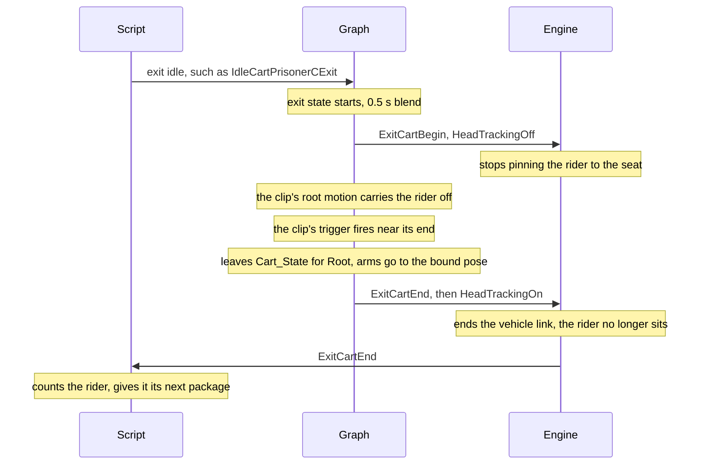

# Vehicles

A vehicle is a reference that carries another reference. There are three kinds of link:

- A cart towed by a horse: `TetherToHorse(horse)` on the cart.
- A rider on a vehicle: `SetVehicle(vehicle)` on an actor. `SetVehicle(None)` takes the actor
  off again.
- A rider on a horse: a placed actor whose `ACHR` has an `XHOR` field
  ([placed references](/formats/placed-references.md)) rides that horse while its package's "Ride
  Horse if possible?" input is true ([package schedules](/engine/package-schedules.md)).

Sources: <https://ck.uesp.net/wiki/SetVehicle_-_Actor> and
<https://ck.uesp.net/wiki/TetherToHorse_-_ObjectReference>.

Each frame, after the idles and the packages, the vehicle pass computes every follower's pose from
its carrier's live pose. A chain works through the same pass: a rider follows the cart, and the
cart follows the horse. A link that would make a loop is refused. A chain deeper than 8 links gives
no pose, because only a loop in plugin or script data can make one.

## Towing

In the game, a towed cart is a set of physics bodies pulled by the horse
([the game's tow rig](/engine/cart-tow-rig.md)). The cart does not steer or brake by itself: it
is dragged, so a cart stops because its horse stops. Its bodies collide like any other physics
body, so in a line of carts nothing but the horses' own stopping places keeps a cart from running
into the one in front. OpenSky does not build those six bodies. It moves
the cart as a trailer on a tow line that has mass, play, and drag:

- `TetherToHorse` first moves a standing horse 200 units ahead of the cart's origin, on the cart's
  +Y axis, facing the cart's way, as the game does. A horse that walks at that moment stays where
  it is.
- The link keeps the horizontal distance from the cart's origin to the horse's origin.
- Each frame the cart moves along the line from where it was toward the horse. So the cart trails
  the horse's path and cuts corners, and a horse that turns on the spot does not swing the cart
  sideways.
- The cart has its own speed along that line. A spring pulls it back to the link's distance, as
  the hitch holds the shaft tip, and the tip may move at most 24 units either way. So a cart lags
  a horse that starts, and rolls on a little after a horse that stops, then settles back. On a
  slope gravity pulls the cart along the line, so it rolls back a little when the horse stops
  uphill. Wheel friction takes 0.4 of its own speed each second.
- The front axle swings toward the horse on a damped spring. It does not snap to face the horse,
  so in and after a curve the cart sways a little.
- The front axle, where the cart's origin is, turns to face the horse. The body trails it: the rear
  axle follows the front one along the line between them, as a towed trailer does. So in a curve
  the front axle swivels against the body, by at most 40 degrees, the limit of the game's
  turntable hinge.
- Before the wheels are known, or for a cart with one axle, the cart's +Y axis, the way its
  shafts point, turns to face the horse. Plugins do not place every cart on its horse's line.
  `MQ101Cart1Ref` and `MQ101Cart1HorseREF` share the yaw 6.062, but the horse stands about
  36 units left of the cart's axis. The hitch moves the horse onto that axis.
- The cart rests on the ground under its wheels. A wheel is a mesh node whose name starts with
  `Wheel`. In `meshes\furniture\prisonercarriage\prisonercarriage01.nif` (read on the install)
  `WheelFrontLeft` and `WheelFrontRight` sit at y 0, under the `FrontBar` node, and
  `WheelBackLeft` and `WheelBackRight` sit at y -215. So the cart's origin is on the front
  axle. The model's bounds start at z 0, so each wheel touches the ground below its centre at
  z 0.
- Each frame the ground under every wheel is sampled. A plane is fitted to those points by least
  squares, then raised until no wheel is below the ground. The cart's origin goes onto that
  plane, and its up axis turns to the plane's normal. So it pitches on a slope or a change of
  slope, and rolls on a side slope. On twisted ground one wheel can lift a little, as it would
  for a real four-wheel cart.
- Until the model has loaded, or for a model with fewer than three wheels, the origin rests on
  the ground below it and the cart tilts with the slope between itself and the horse.
- Plugins place carts a little above the terrain (`Cart1` sits 11.5 units up) and the game's
  physics settles them; OpenSky drops the cart onto the ground instead.
- The ground is the highest of the terrain and the static collision below a point 128 units
  above the cart or the horse, so a bridge or a paved road counts and a roof above does not.
  The carts and horses in a link are not ground. Without ground the cart keeps its height
  relative to the horse.

[WARNING] The tow line approximates the game's physics. Its spring, play, and drag values have no
source; they are chosen to give a small lag and roll. The wheels never slip sideways, and the cart
cannot tip.

## Wheels

In the game, the wheels are free hinge bodies in the physics simulation: contact and friction with
the ground roll them, with no separate ground queries. The cart's six bodies and five joints are
all simulated ([cart tow rig](/engine/cart-tow-rig.md)). OpenSky does not simulate them; it places
the cart by its own ground queries and turns the wheels by distance, as below.

A towed cart whose mesh has wheel nodes turns its wheels as it rolls. The cell build gives such a
cart its own copy of the mesh, with each wheel's shapes bound to its node, the way an animated
object is drawn ([object animation](/engine/object-animation.md)). Each wheel turns about the
model's X axis by the distance it rolled forward, divided by its radius. The radius is the height
of the wheel node's centre: about 59 for the back wheels of the prisoner carriage and about 48 for
the front ones.

Each axle counts how far it rolled and how far it turned. A wheel rolls its axle's distance, plus
its side offset times the turn, so the outer wheel of a curve rolls further than the inner one.

The `FrontBar` node, with the front wheels and the shafts below it, swivels about its own origin
by the angle between the front axle and the body.

## Collision

In the game, the cart's six bodies and five joints are simulated by the physics engine
([wheels](#wheels)). The rest of this section is OpenSky's own rule.

A towed cart's collision moves with the cart. The prisoner carriage's collision has several rigid
bodies joined by hinge constraints, so OpenSky's dynamic world does not simulate it. Instead the cell
build takes the collision of every vehicle follower out of the static set. Each collision query
places those shapes at the follower's live pose, moved from the pose the build placed them at.

A horse is not blocked by the cart it pulls, and a rider by the cart it sits on. Every rider,
and every actor linked by any chain of links to a towed cart, walks with a collision query that
leaves out the moving collision of the towed carts in its own group. Another group's cart still
blocks it, so at Helgen the second cart's horse stops behind the first cart, where both horses'
patrols lead: marker `000BB976` from stage 20, and `000BB97B` from stage 22
([opening cart ride](/engine/opening-cart-ride.md#the-routes)). A patrol leg that ignores static
collision still meets the carts that are not its
own. A rider moves with its seat, so it cannot drift into
a cart. A mounted escort's horse is neither, so a cart blocks it, with the front and back of its
long body ([character shapes](/engine/character-shapes.md)). The cart's own ground search
also leaves it out. A seated player does not walk, so the cart cannot push
the player out of the seat.

The cart has no rolling sound of its own. Its physics bodies play only impact sounds, as every
physics body does: a new contact slower than 60 units a second is silent; above that, each side
plays its own material's impact sound, the heavy sound above 160 units a second when the material
has one, and each material pair plays at most once every 150 ms. The steady creak of the opening
ride is a quest sound ([sounds](/engine/papyrus-session-natives.md#sounds)).

When a follower leaves its carrier, it rests at its last pose. Until its cell is rebuilt, its
collision stays at that pose; after the rebuild it is static again.

## Riders

`SetVehicle` puts the rider's root on the vehicle's root. The rider's seat idle then moves the body
into its seat. In the cart idles, such as `IdleCartPrisonerCIdle`, the root bone has no offset and
the `NPC COM` bone carries the seat, for example (-33.5, -199.6, 138.8) for seat A, in the cart's
frame. This was read from the clips on the install.

A seat idle holds: its state in `0_master.hkx` plays a looping clip (`m_mode` 1), so the rider stays
seated until another idle, such as a cart exit, replaces it ([idle runtime](/engine/idle-runtime.md)).

The player follows the same rule. The player's root sits on the vehicle's root. While the player
plays a seat idle, the first-person eye goes to the clip's `NPC Head [Head]` bone, so the view sits
where that seat's head is. Without an idle, the eye sits the standing eye height above the vehicle's
root.

A horse rider's root sits on the horse's `SaddleBone`, a node of
`meshes\actors\horse\character assets\skeleton.nif` (read on the install). The bone comes from the
horse's live pose every frame, so the rider moves with the horse's gait. Until the horse's skeleton
loads, the rider sits on the horse's root.

The horse walks the rider's package, so it is the horse that enters triggers. At Helgen this
matters: the gate triggers fire only for the riders' horses, never for the cart horses
([opening cart ride](/engine/opening-cart-ride.md#the-gate-triggers)). The rider plays the
clips in `meshes\actors\character\animations\horse_rider\`: `idle.hkx` while the horse stands, and
`walkforward.hkx` or `runforward.hkx` as the horse walks or runs. [WARNING] The walk and run names
follow the horse's own folder; `idle.hkx` was seen on the install. A clip that does not load leaves
the rider in the clip it plays.

The mounted pose comes from the rider's own behaviour graph. Mounting sends the rider's graph a
mount event, or an instant mount event that skips the mount animation, and puts the rider in the
same sit state as a cart passenger. The horse drives no pose of the rider. A rider whose body
loads after it was put on the horse still needs its riding clip, so OpenSky plays it again when
the body arrives.

The player mounts and steers a horse through the mount coordinator ([riding](/engine/riding.md)).

## Where the rest of the engine sees a rider

A rider's vehicle pose is its live pose. Every system that asks where an actor is reads it: the
dialogue camera and the speaker's position, the AI packages, combat, perception, and magic. So a
rider talks from its seat, not from where it was placed.

`MQ101` calls `Game.SetHudCartMode` for the ride, which hides the HUD but keeps the subtitles
([HUD modes](/rendering/hud.md#hud-modes)).

## Drawing

A follower that is not the player is drawn with a delta matrix: its live pose times the inverse of
the placement the cell build drew. The renderer computes it, because only the built scene knows that
placement. The world state is not enough: a walk or a cell crossing writes a new pose there before the
cell is rebuilt with it. The renderer applies the delta on top of the other instance deltas, and a
vehicle delta wins. The cell build marks every follower as simulated, so its draw instance keeps its
FormID.

The player is not drawn this way. The player's feet are placed at the live pose each frame.

A follower is drawn by one cell. When its pose enters another loaded cell, it moves into that cell
and the old cell is rebuilt without it, so it does not vanish when the old cell unloads. For the
frames until the rebuild lands, the old cell still draws it, from its old placement.

Only a cell build that knows the tow link draws a towed cart at its live pose. A script tether,
such as the one in the opening ride, so makes its cell's rebuild urgent: it goes before the first
loads of the cells around it. Without that, the rebuild waited behind every first load, and on a
slow machine the riders sat on no cart for up to a minute.

## Leaving a vehicle

A rider leaves its vehicle in one of four ways:

- `SetVehicle(None)`, or `SetVehicle` with the rider itself, as the
  [Creation Kit wiki](https://ck.uesp.net/wiki/SetVehicle_-_Actor) says.
- The rider's graph sends `ExitCartEnd`. This is the rule for cart passengers.
- A horse rider's package ends ([package schedules](/engine/package-schedules.md)).
- The player dismounts a horse ([riding](/engine/riding.md)).

The cart exit idles lead to a state of the `Cart` machine in `0_master.hkx`. The state sends
`ExitCartBegin` when it starts and `ExitCartEnd` when it ends, and it ends with its clip, which
plays once (`m_mode` 0). This holds for `IdleCartPrisonerAExit` to `IdleCartPrisonerDExit` and
`IdleCartDriverExit` (read on the install).

The `ExitCartEnd` rule comes from the vanilla scripts. Three scripts on the install
call `SetVehicle` (read with `openskycli pex`):

- `QF_MQ101_0003372B` seats ten riders on the two cart rides of the opening and never takes them
  off. It waits for each rider's `ExitCartEnd`.
- `CarriageSystemScript`, the paid carriage ride on quest `DialogueCarriageSystem`, seats the
  player and up to three passengers. To let them off it plays an exit idle and waits for
  `ExitCartEnd`. It never calls `SetVehicle(None)`. Its properties give the player seat
  `IdleCartPrisonerCExit`, the passengers `IdleCartPrisonerAExit`, `IdleCartPrisonerBExit`, and
  `IdleCartPrisonerDExit`. A quick exit plays `IdleCartExitInstant` instead, but only while the
  global `CartQuickExit` is 1, and its default is 0. `0_master.hkx` declares no such event, but
  `idlebehavior.hkx` does: its state `SpecialCartExitIdle` sends `ExitCartBegin` and then
  `ExitCartEnd` as it starts. [WARNING] OpenSky does not play that state yet.
- `CartDriverScript` is the only caller of `SetVehicle(None)`: the carriage driver leaves its seat
  with it, then plays `IdleCartDriverExit`.

So the game ends a link on its own when the exit state ends, and `ExitCartEnd` is the event that
marks that moment. OpenSky takes any actor off its vehicle on that event.

While seated, a rider reads `GetSitState` 3. `ExitCartBegin` frees it from the vehicle. From then
on it moves like any actor, by its root motion through the character controller, with gravity and
ground following ([actor graphs](/engine/actor-graphs.md#pose)). So the exit motion is not applied
in the cart's frame. `ExitCartEnd` acts as `SetVehicle(None)`: the sit state goes back to 0 and the
link clears. Neither event puts the rider on the ground; the controller does.

### How an exit state ends

An exit state plays its clip once and then holds the last frame. It sends `ExitCartEnd` only
when the graph leaves it. Each exit clip carries one trigger near its end that makes the graph
leave:

| Seat | Clip length | Trigger | At | Root motion over the clip | Turn |
| --- | --- | --- | --- | --- | --- |
| A | 8.5 s | `OffsetBoundStandingStart` | 8.3 s | (-16, -380, -2) | about 170 degrees |
| B | 11.0 s | `OffsetBoundStandingCartStart` | 9.0 s | (21, -375, -2) | about -170 degrees |
| C | 15.67 s | `OffsetBoundStandingCartStart` | 15.47 s | (-8, -330, -2) | about 180 degrees |
| D | 18.0 s | `OffsetBoundStandingCartStart` | 17.8 s | (11, -288, 0) | about 180 degrees |
| Driver | 5.67 s | `CartExit` | 5.47 s | (106, 6, 6) | about 100 degrees |

The root motion is in the actor's own space: -Y is backwards. The times and the motion are in
the clips and in `meshes\animationdatasinglefile.txt`.

For the driver, `CartExit` is a plain transition from `Cart_State` to `Root`. For a prisoner,
the trigger is an event of the arm layers in `mt_behavior.hkx`: the machines
`CarryLeftArmBehavior` and `CarryRightArmBehavior` have wildcard transitions on it to their
bound standing states. These transitions are global wildcards (transition flags 0xd00). A
global wildcard also acts on every state machine above it: the top machine leaves the state it
is in, here `Cart_State`, for the state that holds the target. So the same event that binds the
arms takes the prisoner out of the cart state.

The same rule is the only way into `Cart_State`: the top machine has no transition to it. The
`Cart` machine's wildcards on `IdleCartPrisonerCIdle`, the four `IdleCartPrisoner?Sway` events,
`IdleCartDriverIdleStill`, and `IdleCartDriverSway` are global. Those on the A, B, D, and driver
idle events are local (flags 0x900), so a script must send a sway or the C idle first.

While the `Cart` machine is active, the graph variable `bAnimationDriven` is true, so the clip
moves the actor. When the machine is left, the variable is false again, and normal movement and
collision start from where the root motion left the actor. The game does not move the actor to
a marker.

The first-person graph has only seat C: its idle, sway, and exit states, and the same arm
wildcards. So the player always rides in seat C. `IdleCartPrisonerCIdle` puts the player's
camera in a cart view mode that drops the cart's roll, and `IdleCartPrisonerCExit` ends it. The
C exit state also sends `ZeroOutCameraPitch`, which levels the camera.

The exit clips themselves keep the root still: only the body moves. The travel in the table above
is in the project's motion table ([animation data](/formats/animation-data.md)). So from
`ExitCartBegin` OpenSky holds the rider at the seat pose it had then, and moves its root by the
motion table's offset and turn at the clip's current time, in that pose's frame, on the ground
under it. The cart is stopped by then, so the start pose does not move. Worked example: seat A
starts at the cart's root facing the cart's way, and ends 380 units behind it and 16 to its left,
turned about 170 degrees, at the back of the cart.

A rider whose exit idle plays without a live graph leaves at the same time. OpenSky reads from
the graph which of the clip's triggers leave the state: an event that a transition of the exit
state, or of a state that holds it, fires on, or a global wildcard in any of the actor's
behaviour files. The idle ends at the first such trigger, and `ExitCartEnd` goes out then. For
seat B that is 9.0 s into the 11.0 s clip.

`ExitCartEnd` clears the link and the sitting state and does not place the rider anywhere: it
stays where the travel left it. An exit idle with no motion-table travel is OpenSky's fallback
case. Then the rider stands where the clip left its `NPC COM [COM ]` bone, read on the last frame
before the event, at the ground height there, and turns the way that bone faces, compared with
the bind pose, where the body faces +Y.

The player stands at that point too. Its body bone comes from the exit idle's clip, because the
player's body has no clip playback of its own. The player's view keeps its heading.

## Saving

The link is the world state component `vehicleLink`. It is not written to a save. The game allows
no save during the cart ride, so a save never holds one. When a follower leaves its carrier, its
last pose is kept as a transform override. The follower also stands there: the walk it made
before it got on no longer counts as where it is.

## Where OpenSky differs

- The cart is not a set of joined physics bodies: it follows the horse on the tow line above.
- A cart searches the ground under its wheels only while it moves. Once the cart and its hitch
  stand still for half a second, it keeps its pose and searches nothing until the hitch moves.
