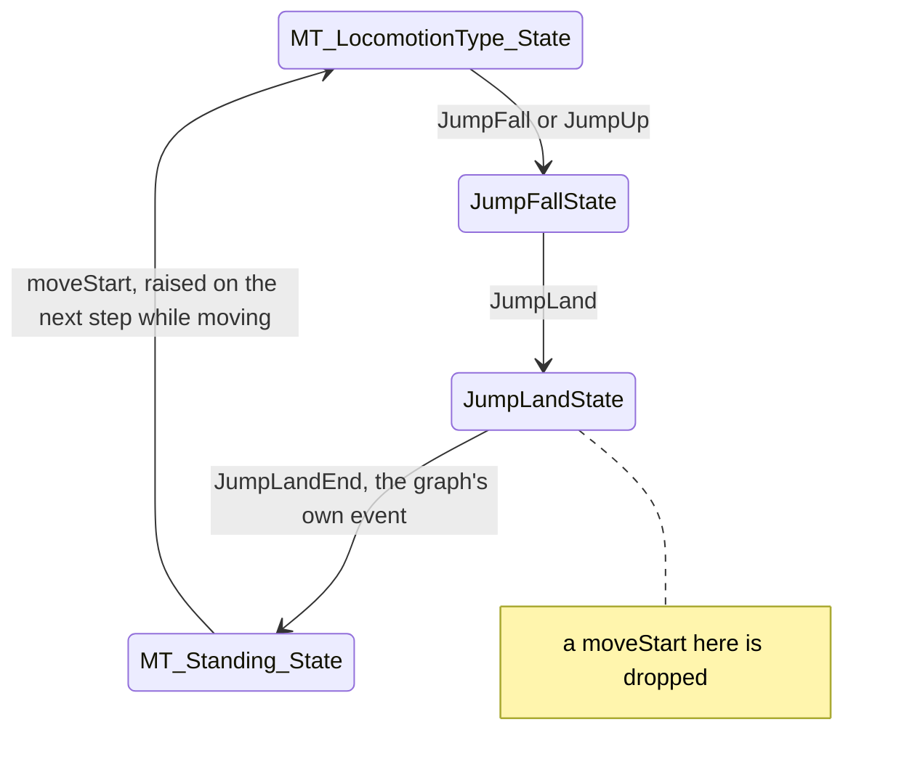

# Walk mode

Fly mode is the default developer camera. `F` (Toggle POV) cycles to walk mode (first person) and
third person. In walk mode a player capsule owns the position and gravity. Mouse look and WASD with
Shift work as in fly mode. `X` and `V` move up and down only in fly mode. The camera modes and the
player body are on the [player camera and body](player-camera.md) page.

## Terrain collision

Each exterior cell keeps an immutable height field on the CPU, beside its terrain draws. It comes
from the same data as rendering ([terrain](terrain.md)):

- `LAND` `VHGT` gives 33x33 heights, with the `XCLC` hidden quadrant mask.
- A cell with no `LAND` in a child world that uses its parent's land data takes the parent's
  `LAND` at the same grid cell, as the drawn terrain does.
- A cell with no `LAND` otherwise gets a flat 33x33 field at the `WRLD` `DNAM` default land height,
  like the drawn fallback plane.
- No `LAND` and no `DNAM` gives no terrain draw and no collision.

Each 128-unit quad uses the same triangles as the terrain mesh: a south triangle SW, SE, NE and a
north triangle SW, NE, NW, sharing the SW to NE diagonal. A sample picks the triangle, interpolates
height with barycentric weights, and takes the face normal from the same vertices. It never uses
bilinear interpolation. On a saddle quad this matters: the drawn diagonal can be at height 0 where
a bilinear center would be 50.

A ground sample also names the ground's material. Each exterior cell resolves its `LAND` textures
into one `MATT` per terrain vertex: the heaviest-weighted texture at that vertex, from the same
ordered blends the terrain shader uses. A sample reports the material of the nearest of the quad's
four corners. Height blends across a face, but material does not: a surface is one material or the
other ([material types](../formats/material-type.md)).

A world XY maps to its loaded cell by floor division. The exact east or north border belongs to
the neighbor. Distant LOD never gives the player ground.

## Settings

The controller owns the capsule bottom (feet), vertical velocity, the grounded flag, and the
leftover step time. Its settings are fixed when the renderer is set up, from the
[game settings](../formats/gmst.md) and movement types:

| Setting | Value |
| --- | --- |
| Capsule radius | 24 units |
| Capsule height | 128 units |
| Eye above feet | 112 units |
| Walk speed | `fMoveCharWalkBase`, fallback 100 units/s |
| Run speed | `fMoveCharRunBase`, fallback 370 units/s |
| Sprint speed | `NPC_Sprinting_MT` `SPED` forward run, 500 units/s |
| Sneak speed | `NPC_Sneaking_MT` `SPED` forward walk, 47.2 units/s |
| Swim speed | `NPC_Swimming_MT` `SPED` forward walk, 80.1 units/s |
| Jump takeoff | `sqrt(2 g fJumpHeightMin)`, 461.3 units/s at 76 units |
| Gravity | 1,400 units/s²; 1.35 times while falling, 4 times on the ground |
| Largest walkable slope | 47 degrees, on the surface the body touches |
| Ground search | 69.99 units (1 physics unit) below the feet |
| Step height | 36 units. No confirmed Skyrim SE game setting. The plank stairs of Riften have risers of up to 33.2 units, and NPCs walk them in the game |
| Physics step | 1/120 s |
| Longest accepted frame | 0.1 s |

Movement uses fixed steps. Frame time over 100 ms is dropped, and a remainder under one step carries
over. Horizontal movement uses the level yaw, not the pitch. Diagonals are normalized.

Sprint, sneak, and swim have no game setting. They come from the `MOVT` movement types
([records](../formats/records.md)), found by editor ID across the load order, so a mod that changes
sneaking changes it here. `fMoveCharRunBase` is not in `Skyrim.esm` and falls back to 370, which is
exactly what `NPC_Default_MT` gives as its forward run.

Jump takeoff is derived: `fJumpHeightMin` (76 units in `Skyrim.esm`) is a height, and reaching
height `h` under gravity `g` needs `sqrt(2 g h)`. So the top of the jump stays at the written height
if either value changes.

## Input

| Key | Action | Vanilla binding |
| --- | --- | --- |
| W, A, S, D | Move | Same |
| Shift (hold) | Run | OpenSky. Vanilla walks by default and toggles with Caps Lock |
| Option (hold) | Sprint | Alt |
| C | Sneak, a toggle | Ctrl |
| Space | Jump | Same |
| F | Camera mode: fly, first person, third person | F switches first and third person. Fly is an OpenSky developer mode |
| E | Use | Same |

macOS uses Control-click as the secondary click, so Control cannot be held during mouse look. That
is why sneak moved. Sneak is a mode, not a held key, so it stays on when the pointer is released.
Sprint and a pending jump are dropped.

## Who moves the capsule

In the game, a non-player actor with its 3D loaded is a character rigid body in the physics
simulation (some actors, by a race or actor flag that is not known, use a proxy controller), and the
floor holds it up through its contacts in the physics step. The player uses a
proxy controller instead. Actors at the Middle-low and Low
[process levels](ai-process-levels.md) have no 3D, so they have no collision shape; their
package moves are simple moves. OpenSky moves every walker with its own capsule controller and
ground tests, described below. A long body such as a horse searches the world for shapes once per
step for all its parts, and reads the ground twice under each end: where it stands and where it
goes. On a marker walk those ground reads share one search per frame over the body's area. A large
static triangle mesh is split into leaves of at most 64 triangles by where the
triangles lie, so a test near one point meets few of them. In OpenSky an actor at a low process
level has no package tree and no walk; the [unloaded actors](unloaded-actors.md) schedule
moves it with no collision.

One bridge is where input, the behavior graph, and the controller meet. Its rules:

- Horizontal motion has exactly one source per fixed step. The bridge picks it and gives the
  controller a displacement, not a velocity or an acceleration. With a planner attached, the
  controller adds no horizontal motion of its own, so no axis is integrated twice.
- Vertical motion belongs to the controller: gravity, ground snap, step support, and the slope rule.
  The bridge may add one jump impulse and may say a step is under water. It cannot integrate height.
- The loop closes through the controller. The feet position, vertical velocity, and grounded flag
  go back to the bridge on the next step and become graph variables.

The horizontal source is the graph's own root motion when the data has any, and the gait speed
otherwise. Vanilla always takes the second path, and that is measured: none of the 2,654 HKX files
under `meshes\actors\character\` contains an `hkaAnimatedReferenceFrame`, and every
`hkaSplineCompressedAnimation` in the movement clips leaves `m_extractedMotion` null. Skyrim's
movement clips animate in place, and the engine supplies the travel. Driving `mt_behavior.hkx` for
three seconds of walking moves the root bone 0.04 units in total. That is jitter, not movement. The
root motion path stays, so data that does carry extracted motion drives the capsule.

The path is chosen from the data, not from a measured distance. The clip evaluator reports root
travel only for a clip whose file has extracted motion ([hka animation](../formats/hka-animation.md)).
A clip with extracted motion that stands still for a step keeps control and reports no travel. An
in-place clip never gains control, however far its root bone drifts. Both hold through a blend.

A speed threshold on the root bone did not work. It was 10 units per second, against a measured
average jitter of about 1. But the test runs per 1/120 s step, so one step where the root moves
0.09 units reads as 10.8 units per second. A few hundred steps of a test route took the wrong path,
and one moved the capsule backwards.

A paused frame does nothing: no graph update, no event, and no movement
([menu mode](menu-mode.md)).

## Gaits, jump, and swim

Sneak wins over sprint, which wins over run. Swimming replaces all three. Crouching cancels a
sprint. The gait sets the speed and the graph's `Speed` variable.

The jump key holds one request until a fixed step uses it. A jump needs solid ground. In the air the
request is dropped, not queued, so a held key cannot jump again on landing. Takeoff sets the
vertical velocity, clears grounded and step support, and raises `JumpUp`. `JumpFall` is raised when
the capsule leaves the ground without jumping, and `JumpLand` when the controller reports ground
again.

After a landing the character graph stands, even with `Speed` held at 200. It drops a `moveStart`
that comes before its landing clip ends. So on the step after the graph fires `JumpLandEnd`, the
bridge raises `moveStart` again while the player moves, and `sprintStart` while the player sprints.
Without this, a player who ran off a ledge glides on in the standing pose.

In the game a character runs on after a landing. How it gets there is only partly known
([locomotion graph](locomotion-graph.md#how-the-game-drives-the-graph)): the landing itself
sends only the land action, and the move-start action comes when the game's own movement state
changes to moving. What changes that state after a landing was not found, so the re-raise after
`JumpLandEnd` is OpenSky's way to match the result.

Water height is `CELL` `XCLW` over the worldspace default ([sky and water](sky-water.md)).
Interiors report none: a vanilla interior places its water as geometry, not as a plane.

Ground, slopes, gravity, swimming, floating, and leaving the water follow the game's rules on the
[ground and water contact](ground-and-water-contact.md) page. The capsule height is the
body height those rules use. OpenSky adds three things of its own:

- The step height above. The game has none: its capsule's round bottom rides over an edge.
- A rising swimmer stops when its float point reaches the 10-unit rest depth, instead of
  passing it. Above that depth, where the game adds no push, gravity pulls it back down. So a
  swimmer settles at the rest depth instead of bobbing.
- While swimming, sneak dives and a held jump key swims up. A jump press with the float point
  within 350 units of the surface jumps out instead.

The player's float level is 1.3 in first person and 1.6 in third person.

## Speed

Worn armour weight slows the player's run and sprint, but never below the walk; the walk keeps
its speed. The weight is the armour weight after perks.
The factor is `1 - effect x (min(weight, fMoveWeightMax) + fMoveWeightMin) / (fMoveWeightMax -
fMoveWeightMin)`. The effect is `fMoveEncumEffect` (0.3) with a weapon drawn, and
`fMoveEncumEffectNoWeapon` (0.15) without one. No plugin sets `fMoveWeightMin`, so it is 0. For
example, 115 weight with a sword drawn leaves 70% of the run speed. The `SpeedMult` actor value
scales every gait first: 120 moves at 1.2 times, and 0 counts as 100. NPCs follow the same rules
([navigation](navigation.md#npc-path-following)).

An NPC turns at `fActorDefaultTurningSpeed` radians a second. A package with a preferred fast
walk or jog moves at walk + (run - walk) x `fFastWalkInterpolationBetweenWalkAndRun` (0.15) or
`fJogInterpolationBetweenWalkAndRun` (0.65).

## Breath and drowning

The player is under water while the eye is below the water surface. Under water the breath
counts down. When it reaches 0, the player loses a part of the maximum health each second.
Above water the breath is full again at once. The settings come from the CK wiki
"Category:Settings" page (<https://ck.uesp.net/wiki/Category:Settings>):

| Setting | Meaning | Value |
| --- | --- | --- |
| `fActorSwimBreathBase` | seconds of breath, before the next term | 10, the wiki default; `Skyrim.esm` does not set it |
| `fActorSwimBreathMult` | adds 50 times its value in seconds | 0.2 in `Skyrim.esm`, so 10 more seconds |
| `fActorSwimBreathDamage` | fraction of maximum health lost each second | 0.08 in `Skyrim.esm` |

The breath lasts 10 + 50 x 0.2 = 20 seconds. Example: with 100 health, a 26 second dive costs 6
seconds at 8 health a second, which is 48 health.

The `Water Breathing` actor value above 0 keeps the breath full. A water breathing effect, or the
Argonian racial ability, raises it. The wiki text for `fActorSwimBreathMult` ("number of minutes
(additive)") does not give its formula; the fixed factor 50 is OpenSky's reading. The breath
refills at once, but the game may refill it over time; this is not measured.

## Ground material

The controller reports the `MATT` of the surface underfoot. It is empty in the air, and on a surface
with no material. Three paths set it, one for each way the capsule becomes grounded:

- Snapping to terrain: the material from the ground sample. Terrain wins over a mesh contact here,
  because this path put the feet down.
- A walkable capsule contact: the material of the flattest walkable contact. A floor and the wall
  beside it can both touch the capsule, and only the floor is stood on. A contact with no material
  is skipped, so a decoration with no material does not silence the step.
- Step support: the material the step probe landed on, so a wooden stair sounds like wood.

[Footstep sounds](footstep-sounds.md) read it once per frame.

## Collision response

The game's rules for walkable slopes, steps, and staying on the ground are on the
[ground and water contact](ground-and-water-contact.md) page.

On terrain, grounded motion refuses a face steeper than the slope limit. An allowed rise snaps the
feet to the drawn surface. Gravity and snap keep contact on the way down. A falling player stops
when the feet cross the ground, at the exact sampled height with zero vertical velocity.

Against meshes, the capsule queries the loaded cells' trees with the swept capsule's box
([static collision](collision-world.md)). Each step is split into moves no longer than half
the capsule radius, so thin surfaces cannot be skipped. The narrow phase handles triangle meshes,
convex hull faces, boxes, spheres, and capsules. Up to eight of the deepest contacts push the
capsule out. The rest of the motion stays, so the capsule slides along a wall. Steep normals block
horizontally. Walkable normals ground the capsule. A downward contact stops falling, and an upward
one stops rising.

A blocked grounded move gets one step attempt. A probe looks ahead and down for a surface no
steeper than the slope limit, so a riser cannot count as support. The controller checks for the
full step height of clearance, moves over the obstacle, and keeps the tread as support until the
capsule's center reaches it. A higher obstacle or a low ceiling fails the check, and the wall
response wins. The same probe crosses from terrain to a mesh stair.

A door or the first scene placement resets the whole controller state before the next step. Moving
bodies collide through the same query ([dynamic bodies](dynamic-bodies.md)).

## Border regions

A border region is a `REGN` with record flag `0x40` (xEdit "Border Region") in the current
worldspace. Its `RPLD` outline is the edge of the playable world: `BorderRegionSkyrim` rings
Tamriel with 173 points. A walk step that would take the player from inside an outline to
outside every outline does not move sideways, and the HUD shows
`sPlayerLeavingBorderRegion` ("You cannot go that way.") once each time the edge first holds
the player. A worldspace without border regions, and a player who is already outside, move
freely. A mount is not held yet.

## The walk route gate

`WalkPathGateRealDataTests` (`make test PLAN=Perf`) runs a fixed route. Fixed 1/30 s input frames
drive 1/120 s steps from Tamriel cell `(6,-2)` across streamed terrain to Chillfurrow Farm `(7,-3)`,
around fixed waypoints, with small fixed sidesteps when a small static blocks progress. It requires:

- grounded travel with no penetration or fall-through on any active frame;
- at least 16 units of climb on the outside stair before door `0001633D`;
- interior `CELL` `00016204`, two waypoints inside covering 80% of 192 units, and the way back out
  through the paired door `000163A8` to cell `(7,-3)` and the saved return pose;
- a mean physics frame time of at most 33.33 ms (30 fps) in every build. The p95 limit is 33.33 ms
  in Release and two intervals (66.67 ms) in Debug, because the offscreen loop carries Debug
  runtime and scheduler noise.
