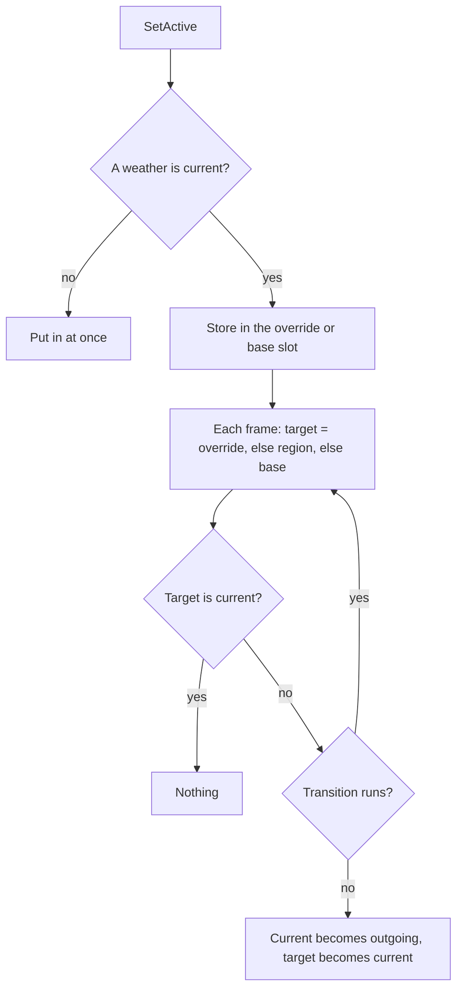

# Weather runtime

Exterior weather comes from the [weather records](../formats/weather.md) (`WTHR`, `CLMT`, `REGN`),
the worldspace climate (`WRLD` `CNAM`), and the cell regions (`CELL` `XCLR`). The runtime picks a
weather for the current worldspace. It cross-fades between weathers over time. It blends the four
time-of-day keyframes of each weather by the hour from the [game clock](game-clock.md).
The result drives the sky colors, fog, directional ambient light, and sun tint.

With no weather data, or no candidate for the worldspace, there is no weather. The renderer then
draws its procedural sky and camera lighting exactly as it would without this system.

## The weather store

The store decodes every `WTHR`, `CLMT`, and `REGN` once, and reads each worldspace's climate and
editor ID. It is built on the setup thread. After that it holds only immutable values, so the
render thread can read it while the cell builder reads the plugin on its own queue.

## Choosing candidates

The candidate pool for a worldspace and the current cell's regions follows the xEdit meaning of
`REGN`:

1. The regions that apply are the cell's `XCLR` regions with a weather area (`RDAT` type 3) whose
   `WNAM` is this worldspace, or is unset. They are sorted by weather priority. The highest wins.
2. The winning region's `RDWT` list is the pool.
3. If that area's override flag is clear, the worldspace climate's `WLST` list is added after it.
   If the flag is set, the region list stands alone.
4. With no region that applies, the pool is the climate list. With no climate, the pool is empty
   and there is no weather.

The pick is a draw weighted by chance, seeded from the worldspace FormID and a reroll counter. So
the same counter always picks the same weather. If every chance is 0, every candidate is equally
likely.

The Clear, Rain, and Snow shortcuts first look for a vanilla editor ID: `SkyrimClear`,
`SkyrimOvercastRainFF`, `SkyrimStormSnow`. If it is missing, they take the first weather, sorted
by editor ID, with the matching precipitation class. So the shortcuts also work with other data.

## Region changes

Cell streaming reports the regions of the exterior cell at the grid center when they change.
Selection then runs against the cell the camera is in. A changed region set rerolls at once,
unless a weather is forced.

Two cases keep the last region set:

- A center cell that has not loaded yet is skipped. A short loading gap must not drop the region
  weights.
- An interior sends no regions. Weather is exterior only, so leaving a building resumes the same
  weather.

## The climate chance global

Each `CLMT` `WLST` entry has an optional `GLOB` beside its chance. No open source says what the
game does with it. UESP lists the field as `formid - Global`, and xEdit names it `'Global'`, both
without a comment.

OpenSky's choice: a global that resolves replaces the entry's chance. An entry with no global, or
a global the data does not define, keeps its written chance. The value is rounded half away from
zero and clamped to 0 or more, because the pick adds the weights.

Replacing was chosen over scaling. A scale factor has no documented neutral value, and a global
that defaults to 0 would silently delete the weather. With replacement the written number is the
fallback and the global is the override, like every other runtime value. Change this if a real
description is found.

The `REGN` `RDWT` global is ignored.

When a global changes, the system rerolls at once, so the weather follows it without waiting for
the next reroll time. See [runtime state](runtime-state.md).

## Transitions

The system holds a "from" weather, a "to" weather, and a progress from 0 to 1. A reroll, or a
forced change with a transition, stores the current look as "from", sets the new "to", and resets
progress to 0. Each frame, progress grows by the game hours that passed divided by the duration.
The blend uses a smoothstep of the progress. At 1, "from" becomes "to".

An automatic reroll happens after an interval set by the climate's volatility (`CLMT` `TNAM`
byte 4). The Creation Kit wiki page "Climate" (<https://ck.uesp.net/wiki/Climate>) says a higher
volatility changes the weather more often, but gives no formula. OpenSky uses
`6 * 50 / volatility` game hours:

| Volatility | Interval |
| --- | --- |
| 50 (`SkyrimClimate` in `Skyrim.esm`) | 6 game hours |
| 100 | 3 game hours |
| 0 (such as Blackreach) | never; only a region change or a script changes it |
| no climate | 6 game hours |

The hours come from how far the game clock moved since the last frame, not from the hour value
itself. So:

- Scrubbing forward ages the weather, up to one day per step.
- Scrubbing backward ages nothing.
- A clock that does not move (an offscreen render, the CLI, a paused game) never rerolls.

Pausing transitions stops only the cross-fade progress. A forced weather can still replace a "to"
weather that has not started. Frames and rain and snow particles keep running. Resuming continues
from the same progress.

## Transition duration

A transition takes `0.01 + d / 255 × 0.24` game hours, with `d` the `WTHR` `DATA` "Trans Delta"
byte of the incoming weather. So the shortest takes 0.01 game hours and the longest 0.25: 1.8 to
45 real seconds at the default timescale of 20. Most `Skyrim.esm` weathers store 125, such as
`SkyrimClear`, `SkyrimFog`, `SkyrimCloudy`, and `HelgenAttackWeather`. That is 0.1276 game hours,
7.7 game minutes, about 23 real seconds.

The transition follows the game clock. The timescale changes its speed, it stops while the clock
stops, and waiting or resting in a bed finishes it in one step. It ends when the progress passes 1.

[WARNING] OpenSky scales the byte to 0 ... 0.25 game hours with no 0.01 floor, so a delta of 0
switches at once.

## The first weather

Entering a worldspace applies its climate and clears the weather. A worldspace with no climate
uses `DefaultClimate` (`0000015F`). The next update with no current weather takes the first of
these, and puts it in at once:

1. the override weather;
2. the region's weather, drawn by chance, with a chance of 0 skipped; an interior with a sky uses
   its cell's sky region;
3. the base weather;
4. the climate's weather list (`SkyrimClimate` lists `SkyrimCloudy` at 100);
5. `DefaultWeather` (`0000015E`).

## Time-of-day blend

The hour and the climate's `TNAM` sunrise and sunset windows give four weights: sunrise, day,
sunset, night. They always add up to 1. At most two neighbors are above 0 at once.

The game widens both windows by half an hour before it blends: the sunrise starts 0.5 hours
earlier (not before 00:00), and the sunset ends 0.5 hours later (not after hour 23.99). Each
window is then a straight-line tent:

| Hour | Weights |
| --- | --- |
| Before the widened sunrise start, or after the widened sunset end | night 1 |
| From the sunrise start to the window's middle | night falls to 0, sunrise rises to 1 |
| From the middle to the sunrise end | sunrise falls to 0, day rises to 1 |
| From the sunrise end to the sunset start | day 1 |
| From the sunset start to the window's middle | day falls to 0, sunset rises to 1 |
| From the middle to the widened sunset end | sunset falls to 0, night rises to 1 |

For example, `SkyrimClimate` has a sunset from 16:00 to 20:30. Widened, it ends at 21:00, and
its middle is 18:30. At 19:00 the weights are sunset 0.8 and night 0.2; from 21:00 on, night is 1.

The same four weights blend every field with four keyframes: sky colors, directional ambient, and
wind. So they all change together. Without `TNAM` the windows are 05:00 to 07:00 and 17:00 to
19:00. Timing that does not go forward (for example a sunset before the sunrise) also uses these
defaults.

One resolved weather holds:

- sky colors (`NAM0`): upper, lower, horizon, sun, sun glare, stars;
- fog (`FNAM`): near and far colors, and distances, power, and maximum blended between day and
  night;
- sunlight and ambient colors (`NAM0`);
- the six-direction ambient (`DALC`);
- wind;
- a precipitation state from the rainy and snow classes.

A missing field resolves to zero or "off" and does not throw. Two resolved weathers are blended
by linear interpolation during a transition, and the transition sets the precipitation strength.
See [precipitation volumes](../rendering/precipitation.md).

## Wind

Wind is a unit direction in XY, a speed from 0 to 1, and a range of meander in degrees, from
`WTHR` `DATA`. During a transition it blends as a velocity, direction times speed. So two opposite
winds pass through calm instead of flipping 180 degrees. The renderer publishes the current wind,
calm when there is no weather, for rain, particles, and grass.

## Renderer use

The weather applies only to exteriors. Interiors keep their `CELL` and `LGTM` lighting.

- The weather sky colors drive the sky shader.
- Weather fog, ambient, sun tint, and directional ambient replace the camera fallback values.
- The sun direction and the light direction follow the sun path of the
  [celestial sky](celestial-sky.md). The weather sets only their colors.
- The textured sun and its glare replace the shader's drawn sun disc and glow once their
  textures load. With no weather, the sky takes the original procedural path, with a fixed sun.

## Clouds

Each enabled cloud layer of the current weather draws on its shape of the cloud dome
([weather record](../formats/weather.md)). A layer is skipped when its index is at or past `LNAM`,
when `NAM1` disables it, or when it has no texture. Its colour and alpha blend from `PNAM` and
`JNAM` by the same time-of-day weights as the sky. During a transition both weathers' layers
draw, each faded by its share of the blend.

A layer's texture moves `0.1 * fWeatherCloudSpeedMax * (raw / 127 - 1)` texture units per
second of real time, across by its `QNAM` byte and along by its `RNAM` byte. The setting is 0.1
and no vanilla plugin sets it, so a layer moves at most 0.01 units a second. A plugin that sets
it changes every layer's speed. Wind does not move clouds. Behaviour described from a
clean-room read of `SkyrimSE.exe` 1.7.104.0 on 2026-11-06.

There is one texture offset per layer index, not per weather. During a transition both
weathers draw a layer index at that one offset, and it moves at the two weathers' speeds,
blended by the transition. So the old and the new cloud sheet of a layer move as one sheet
while they cross-fade. A layer index one weather does not use counts as still for it.
OpenSky wraps the offset at one texture repeat, so a long session keeps float precision.
`openskycli game state time` shows each moving layer's `velocity` and `offset` under
`sky.clouds`.

The dome draws right after the sky, with alpha blending and no depth writes, at the far end of
the depth range. The dome and the textures load off the main actor; until they land, the sky
draws without clouds. Interiors draw no clouds.

## Scripts

The `Weather` natives reach the weather system through the script world adapter
(<https://ck.uesp.net/wiki/Weather_Script>):

- `ForceActive(bool abOverride = false)` puts the weather in at once. It drops a running
  transition and every waiting request, and resets rain, snow, and lightning. With the override,
  the weather goes into the override slot. Without it, the weather becomes the base weather and
  the override is cleared.
- `SetActive(bool abOverride = false, bool abAccelerate = false)` only records a request. With the
  override it replaces the override slot, so the last call wins, whichever script made it.
  Without it, it sets the base weather. When no weather is current yet, it acts as `ForceActive`.
- `ReleaseOverride()` clears the override. The next update chooses again, with a normal
  transition.
- `GetCurrentWeather()` returns the weather the sky shows or moves to.
- `FindWeather(int auiType)` returns the first candidate of the current regions with that
  classification: 0 pleasant, 1 cloudy, 2 rainy, 3 snow. `GetClassification()` reads the same
  codes from the `DATA` flags, and -1 for none.

Each frame the target is the override weather, else the region's weather, else the base weather.
A request never gets lost. While a transition runs it waits, and only the last request per slot
is kept:

An override ends on its own when more than `1 + 22 × (255 − volatility) / 255` game hours have
passed since the last transition started. For `SkyrimClimate`, volatility 50, that is 18.7 game
hours. A change of climate clears every weather, the override too. Going into an interior keeps
the override. In an interior with no sky the weather stands still, and a change that starts there
is instant.

`abAccelerate` works only while a transition runs at the call. From then on the progress is
`p0 + (p − p0) × (fWeatherTransAccel + 1)`, with `p0` the progress at the call and `p` the normal
progress. `fWeatherTransAccel` is 16 in `Skyrim.esm`, so the rest runs 17 times faster. A second
accelerate changes nothing, and the next weather fades at the normal speed.

[WARNING] OpenSky starts a new transition at every `SetActive` call, even while one runs, instead
of letting the request wait. It has no override expiry, and it divides the fade's length by
`fWeatherTransAccel`.

## The opening

The opening's scripts change the weather several times (read from the install's scripts):

- `MQ101` stage 10 calls `ForceActive(true)` on `SkyrimClear`.
- `FXChargenFXScript`, on a reference near the cart road, runs once when the reference loads. It
  calls `SetActive(true, false)` on `SkyrimFog`, waits 10 s, applies the chargen image space
  modifier, and waits 75 s. It then calls `SetActive(true, false)` on `SkyrimCloudy`
  (`00012F89`), and 65 s later disables and deletes itself.
- `MQ101` stage 150 forces the attack weather.

Stage 10 runs its first log entry, whose condition is the global `MQQuickstart` at 0. Stage 30
also calls `ForceActive(true)` on `SkyrimClear`, but only in its second log entry, for
`MQQuickstart` 1; a new game runs the first entry, which has no weather call. So in a new game
the fog gives way to `SkyrimCloudy` about 85 s after the script starts, before the carts reach
Helgen.
