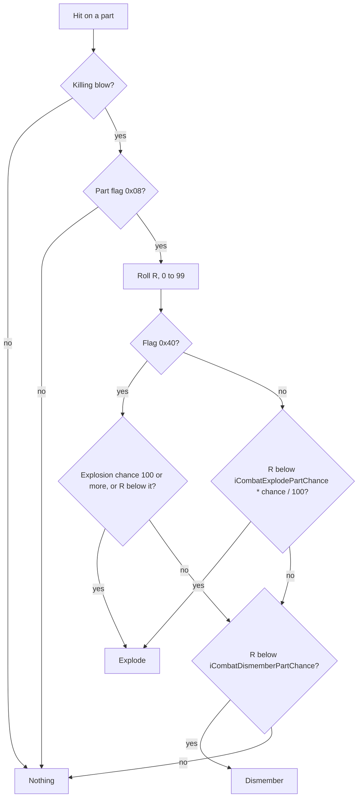

# Body part data

`BPTD` names the parts of a creature that can be hit, cut off, or blown apart. A race links
it through `RACE GNAM`.

Source: xEdit `dev-4.1.6`, commit `9fb0168`,
[`wbDefinitionsTES5.pas`](https://github.com/TES5Edit/TES5Edit/blob/dev-4.1.6/Core/wbDefinitionsTES5.pas)
and
[`wbDefinitionsCommon.pas`](https://github.com/TES5Edit/TES5Edit/blob/dev-4.1.6/Core/wbDefinitionsCommon.pas).
All integers are little-endian. Field and size counts were checked on the five masters of the
install with a field census.

## Parts

After `EDID` and the model group, the record is a list of parts. A part starts at `BPTN`,
or at `BPNN` when the current part already has a node name. 49 records hold 111 parts on
the install.

| Field | Type | Meaning |
| --- | --- | --- |
| `BPTN` | lstring | Part name |
| `PNAM` | zstring | Pose-matching node |
| `BPNN` | zstring | Skeleton node the part sits on |
| `BPNT` | zstring | VATS target node |
| `BPNI` | zstring | IK start node |
| `BPND` | 84 bytes | Node data, below |
| `NAM1` | zstring | Limb-replacement model |
| `NAM4` | zstring | Gore target bone |
| `NAM5` | bytes | Texture hashes, kept raw |

## BPND

| Offset | Type | Meaning |
| --- | --- | --- |
| 0 | float | Damage multiplier |
| 4 | uint8 | Flags: 0x01 severable, 0x02 IK data, 0x04 IK biped data, 0x08 explodable, 0x10 IK is head, 0x20 IK head-tracking, 0x40 absolute to-hit chance |
| 5 | uint8 | Part type: 0 torso, 1 head, 2 eye, 3 look-at, 4 fly grab, 5 saddle |
| 6 | uint8 | Health percent |
| 7 | int8 | Actor value, -1 for none |
| 8 | uint8 | To-hit chance |
| 9 | uint8 | Explosion chance |
| 10 | uint16 | Explodable debris count |
| 12 | FormID | Explodable debris `DEBR` |
| 16 | FormID | Explodable explosion `EXPL` |
| 20 | float | Tracking max angle |
| 24 | float | Explodable debris scale |
| 28 | int32 | Severable debris count |
| 32 | FormID | Severable debris |
| 36 | FormID | Severable explosion |
| 40 | float | Severable debris scale |
| 44 | 3 floats | Gore offset |
| 56 | 3 floats | Gore rotation |
| 68 | FormID | Severable `IPDS` |
| 72 | FormID | Explodable `IPDS` |
| 76 | uint8 | Severable decal count |
| 77 | uint8 | Explodable decal count |
| 78 | 2 bytes | Not named by xEdit, kept |
| 80 | float | Limb-replacement scale |

Node names match a skeleton without regard to case.

## Skeleton nodes

A `BPTD` part names a skeleton node in `BPNN`. OpenSky checks each name against the
string table of a skeleton mesh, without case, as a hit or a miss. The skeleton is the
male `ANAM` of a race whose `GNAM` names the `BPTD`. A miss is reported, never a crash.

On the five masters 44 of the 45 `BPTD` records belong to a race. One node name misses:
`DwarvenBallistaCenturionBodyPartData` names `NPC_mainbody_bone`, which its skeleton
does not hold. Parts can also be listed by the `BPND` part type byte.

## In the game

### Which part a hit strikes

A projectile hit, from an arrow or a spell, takes its part from the node of the actor the
projectile touched. The contact point is the hit point, and the flight direction is the hit
direction. A melee hit, or any other hit without a projectile, draws a line toward the target
and takes the node of the target's model that the line crosses. From the player the line follows
the aim and is 512 units long. From an NPC it runs from the attacker's torso to the target. When
the line finds no point on the model, the hit point is 32 units along the line between the two.

The node gives a part type (`BPND` byte 5). The hit keeps only the type. A later step asks the
actor's `BPTD` for its part of that type. The part's to-hit chance is the weight of a roll with
one candidate, so it only matters at 0: then no part is noted. Flag `0x40` does not choose the
part; it changes the explode roll below.

### Damage multiplier

The part's damage multiplier counts only for a weapon outside the melee animation types (hand to
hand up to two-handed axe), so for bows, crossbows, and staffs. A melee weapon and a spell use 1.
The multiplier never lowers a hit: the hit's damage multiplier becomes
`max(multiplier so far, part multiplier)`.

### Limb damage

```text
limb damage = damage / (target base Health * health percent / 100) * 100
```

A health percent of 0 gives no limb damage. A base Health of 0 or less gives the raw damage. On
the player, limb damage is multiplied by `fCombatPlayerLimbDamageMult` (0.5 in `Skyrim.esm`). Perk
entry point Adjust Limb Damage (4) changes it last. The part's actor value then takes that much
damage, as a damage change that a restore can undo. A part with actor value -1 is skipped. A hit
that takes the value from above 0 to 0 or less marks a crippled limb.

Example: base Health 200, health percent 5, damage 20. The limb takes
`20 / (200 * 0.05) * 100 = 200`.

### Dismember and explode



- A killing blow is a hit after which the target's Health minus the hit's damage is 0 or less.
- Both outcomes need the explodable flag `0x08` on the part. The severable flag `0x01` is not
  checked here.
- `iCombatExplodePartChance` is 75 and `iCombatDismemberPartChance` 50 in `Skyrim.esm`. Without
  flag `0x40` the explode test is against `int(75 * explosion chance * 0.01)`.
- Power attacks, kill moves, critical hits, and perks do not change the roll.
- The weapon's on-hit setting changes the result: 1 turns any success into a dismember, 2 into
  an explode, and 3 stops both. 0 keeps the roll.

Example: explosion chance 40, no flag `0x40`. The explode test is `R < 30`, so a roll of 12
explodes the part, 41 dismembers it, and 60 does nothing.

An explode places the explodable explosion at the hit point and throws the explodable debris:
its count, at the explodable debris scale times the actor's scale. The limb-replacement model is
attached at the absolute value of the limb-replacement scale. The limb is hidden after
`fExplodeLimbRemovalDelay` seconds (0.03), or `fExplodeLimbRemovalDelayVATS` (0) in VATS.

The INI switch that disables all gore stops all of this, and also blood decals, hit splatter,
and decapitation.

### Decapitation

A decapitation is not a dismember roll. The `Decapitate` animation event starts it, as kill moves
send. It needs a head that is still on and a race decapitation item for the actor's sex. The game
equips that item, marks the head as gone, and throws the head along the push direction at 250
units a second. The blood effect after it lasts 5 seconds.

### Vanilla data

In `Skyrim.esm` every part has flags 0 except the draugr head (`0x32`) and the dragon head
(`0x16`). `Dawnguard.esm` adds one more `0x16` part and `Dragonborn.esm` two. Every part has damage
multiplier 1, actor value -1, health percent 5, and to-hit chance
100. No part in `Skyrim.esm`, `Dawnguard.esm`, or `Dragonborn.esm` is severable or
explodable, so vanilla actors never dismember or explode this way.

## Where OpenSky differs

A hit lands on the actor, not on one of its nodes. So the parts of `BPND` that work per hit are
not used yet: the damage multiplier, the health percent, the to-hit chance, and the
actor value of a limb. Severing and exploding on a killing blow use the part data and the weapon's
On Hit setting as this page describes.
