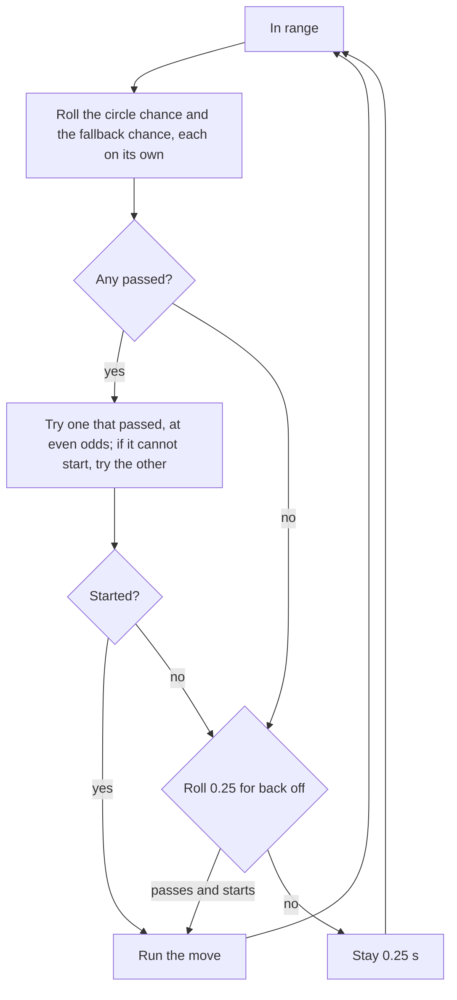

# Combat style records

`CSTY` holds the weights an actor's combat AI uses. An NPC links one through `NPC_ ZNAM`.

Source: xEdit `dev-4.1.6`, commit `9fb0168`,
[`wbDefinitionsTES5.pas`](https://github.com/TES5Edit/TES5Edit/blob/dev-4.1.6/Core/wbDefinitionsTES5.pas)
and
[`wbDefinitionsCommon.pas`](https://github.com/TES5Edit/TES5Edit/blob/dev-4.1.6/Core/wbDefinitionsCommon.pas).
All integers are little-endian. Field and size counts were checked on the five masters of the
install with a field census.

## Fields

Each block is a run of floats that may stop early; xEdit marks every member optional. The
install has `CSGD` at 8, 32 and 40 bytes, `CSME` at 28 and 32, `CSCR` at 8 and 16, and
`CSFL` at 4, 12 and 32. A block that stops early keeps the default for each float it lacks. A
new style starts as a copy of the game's default combat style, when one is set.

| Field | Members, in order |
| --- | --- |
| `CSGD` | Offensive, defensive, group offensive multipliers; equipment score multipliers for melee, magic, ranged, shout, unarmed, staff; avoid threat chance |
| `CSMD` | 8 bytes not named by xEdit. The game skips it at load |
| `CSME` | Attack staggered, power attack staggered, power attack blocking, bash, bash recoil, bash attack, bash power attack, special attack multipliers |
| `CSCR` | Circle multiplier, fallback multiplier, flank distance, stalk time |
| `CSLR` | Strafe multiplier |
| `CSFL` | Hover chance, dive bomb chance, ground attack chance, hover time, ground attack time, perch attack chance, perch attack time, flying attack chance |
| `DATA` | uint32 flags: 0x01 dueling, 0x02 flanking, 0x04 allow dual wielding |

Header flag 0x80000 is an older allow-dual-wielding switch.

## Defaults

| Field | Default |
| --- | --- |
| `CSGD` | Offensive 0.5, defensive 0.5, group offensive 1, the six equipment multipliers 1, avoid threat 0.2 |
| `CSME` | The first seven values 1, special attack 0.1 |
| `CSCR` | All four values 0.2 |
| `CSLR` | 0.2 |
| `CSFL` | 0.5, 1, 0.5, 0.5, 0.5, 0.5, 0.5, 0.75, in the member order above |
| `DATA` | 1: dueling only |

## What the values change

Most values pick a point between two game settings. In this section,
`lerp(v, Min, Max) = Min + (Max - Min) * v`. Example: a circle multiplier of 0.2 gives a circle
chance of `lerp(0.2, 0, 0.75) = 0.15`.

| Value | Formula |
| --- | --- |
| Fallback chance | `lerp(fallback, fCombatFallbackChanceMin 0, fCombatFallbackChanceMax 0.5)` |
| Fallback distance | `lerp(fallback, fCombatFallbackDistanceMin 96, fCombatFallbackDistanceMax 256)` units |
| Fallback wait | `lerp(fallback, fCombatFallbackWaitTimeMin 0.75, fCombatFallbackWaitTimeMax 1.5)` s |
| Circle chance | `lerp(circle, fCombatCircleChanceMin 0, fCombatCircleChanceMax 0.75)` |
| Distant circle chance | `lerp(circle, fCombatCircleDistantChanceMin 0.25, fCombatCircleDistantChanceMax 0.75)` |
| Circle angle | `lerp(circle, fCombatCircleAngleMin 30, fCombatCircleAngleMax 90)` degrees |
| Flank distance | `lerp(flank, fCombatFlankingDistanceMin 0, fCombatFlankingDistanceMax 1024)` units |
| Stalk time | `lerp(stalk, fCombatFlankingStalkTimeMin 0.01, fCombatFlankingStalkTimeMax 10)` s |
| Strafe chance | `lerp(strafe, fCombatStrafeChanceMin 0, fCombatStrafeChanceMax 0.75)` |
| Special attack chance | `lerp(special, fCombatSpecialAttackChanceMin 0, fCombatSpecialAttackChanceMax 1)` |
| Block chance | `lerp(defensive, fCombatBlockChanceMin 0, fCombatBlockChanceMax 1)`, times `fCombatBlockChanceWeaponMult` 0.25 without a shield |
| Block attack chance | `lerp(defensive, 0, 1)` |
| Hover, dive bomb, ground attack, perch, flying attack chances | `lerp(v, 0, 1)` |
| Hover time | `lerp(hover time, fCombatHoverTimeMin 5.5, fCombatHoverTimeMax 15)` s |
| Ground attack time | `lerp(ground attack time, 8, 17)` s |
| Perch time | `lerp(perch time, 4, 15)` s |

The circle angle is then drawn at random between `fCombatCircleAngleMin` and the lerped value.
Against the player it is multiplied by `fCombatCircleAnglePlayerMult` (0.75). It is never less
than `radius * fCombatCircleMinDistanceRadiusMult (3) / distance` radians, turned into degrees,
where `radius` is the actor's own. An angle above `fCombatCircleAngleMax` (90) cancels the circle.

### Close-range movement

A movement loop chooses one branch at a time and runs it until it succeeds or fails. It checks
the branches in this order: out of range, out of position, in range.

| Where | Choices |
| --- | --- |
| Out of range | Fall back to a ranged weapon, advance, surround, distant circle, or stay |
| Out of position | Reposition, surround, or stay |
| In range | Circle, fall back, back off, or stay, as below |

Out of range means the distance predicted half a second ahead is above the actor's reach plus its
inner advance radius. Out of position means the actor holds no place around its target, or has
moved out of it. The [combat movement](/engine/combat-movement.md) page gives those two branches,
and the strafe, which only the ranged movement loop uses.

A move starts only while the actor is not attacking and faces the target within 30 degrees. It
asks for a navmesh path to its point, and a point no path reaches fails the move. A running move
is checked every 0.1 s, fails when its path fails, and succeeds when its path ends. In the rules
below, `reach` is the actor's melee reach as the [approach](/engine/combat-approach.md) uses it.

Back off:

- starts only while the target is not moving away, and only when the distance is below
  0.75 times `D = reach + inner advance radius`
  ([advance radii](/engine/combat-approach.md#advance-radii));
- walks straight back from the target to distance `D`, with a 64-unit navmesh tolerance;
- also succeeds as soon as the actor moves toward the target.

Circle:

- takes the vector from the target to the actor, at least `reach` long, and turns it about the
  target by the circle angle, with the height kept;
- picks the left or right side at even odds, and tries the other side once if the first fails;
- a side fails when its point is more than 75 degrees off the target's facing, or when no path
  reaches it within `max(radius, 64)` units;
- succeeds early when the target's distance half a second ahead is above 1024 units plus a
  per-fighter distance, or when the current path point is within `0.5 * reach` of the target.

Fall back:

- starts only while the target faces the actor within 60 degrees and is not moving away;
- goes straight away from the target, to `reach + F` from it, with
  `F = max(fallback distance, 2 * radius)`; that must be more than the current distance;
- uses a navmesh tolerance of `max(radius, 64)` units;
- is first checked 0.5 s in, then every 0.1 s. It is cancelled, once the actor is more than
  1.5 radii from its path point, when the target's distance half a second ahead is above 256
  units plus the per-fighter distance, when the actor moves toward the target, or when the
  path point lies within 20 degrees of the direction to the target or 90 to 160 degrees off it;
- ends with a wait of the fallback wait, or 0.75 s after a cancelled retreat.

Example: circle 0.2 and fallback 0.2 give a circle chance of 0.15 and a fallback chance of 0.1.
Both pass together 1.5 % of the time. When neither passes, which is 76.5 % of the time, back off
rolls its 0.25.

### Attack and bash chances

An actor in reach rolls its attack chance in a loop. A pass first rolls the special attack chance;
when that starts a special attack, the pass ends. Otherwise it rolls the attack chance, and on a
pass it tries the [attack pick](/engine/attack-data.md#the-ais-pick). When no attack starts, the
actor waits 0.25 s and rolls again, so a waiting actor rolls about four times a second. A started
attack holds the loop until the attack state is back to none or reaches the combo window.

The attack chance starts at `lerp(offensive, fCombatAttackChanceMin 0.05,
fCombatAttackChanceMax 1)`. Then:

- a staggered target multiplies it by the larger of the attack staggered and power attack
  staggered values, and the two blocking terms below are skipped;
- otherwise, only while the attacker itself blocks: a target that draws or swings an attack
  multiplies it by `fCombatAttackChanceBlockingSwingMult` (0), and any other target by a value
  that falls from `fCombatAttackChanceBlockingMultMax` (0.67) at defensive 0 to
  `fCombatAttackChanceBlockingMultMin` (0.2) at defensive 1;
- the time since the actor's last melee hit frame or projectile release raises it, from 1 times
  to `fCombatAttackChanceLastAttackBonus` (1.5) times over
  `fCombatAttackChanceLastAttackBonusTime` (5 s). Before the first hit frame there is no bonus.

Example: offensive 0.5 gives `0.05 + 0.95 * 0.5 = 0.525`. Two seconds after its last hit frame
the actor rolls `0.525 * 1.2 = 0.63`.

A separate block loop makes the defensive choices. Each pass tries, in order: the block attack
chance, a block raised against a swing in its windup; the offensive bash chance, a bash without a
block; and the block chance. While either block holds, the actor rolls the bash chance every
0.25 s. When none passes it waits 0.25 s. The [combat blocking](/engine/combat-blocking.md) page
gives when each starts and ends.

The bash chance is `lerp(defensive, fCombatBashChanceMin 0.025, fCombatBashChanceMax 0.2)` and
the offensive bash chance `lerp(offensive, fCombatOffensiveBashChanceMin 0,
fCombatOffensiveBashChanceMax 0.05)`. Both are multiplied by the bash value and by one more
factor: bash recoil for a recoiling target, bash power attack for a power-attacking target,
bash attack for an attacking target, or `fCombatBashTargetBlockingMult` (0) for a target that
blocks toward the attacker within the 35 degree hit cone.

The attack staggered, power attack staggered, and power attack blocking values also weight the
choice between attacks ([attack data](/engine/attack-data.md#the-ais-pick)).

With flanking, the flank distance is added to the actor's reach to give the distance a flanking
path may swing out to. A stalk starts only within `reach + 256` and keeps the actor between its
reach and `reach + 256`. Within `reach + 384` the flank goal may lie at any angle
([flanking](/engine/combat-movement.md#flanking)).

`DATA` 0x04, together with race `DATA` flag 0x40000000, lets a weapon that only fits the right
hand go in either hand ([dual wielding](/engine/combat-blocking.md#loops-that-run-together)).
`DATA` 0x02 makes the actor always use flanking movement; without it the actor never flanks. No
reader of the dueling, charging, or retarget bits is known.

## The general block

`CSGD` drives most combat choices through two values:

- The offensive value `O` is the offensive multiplier. When the group offensive multiplier is
  below 1 and `n` actors, more than one, fight the player, an attacker of the player uses
  `O = offensive * max(groupOffensive^(n - 1), fCombatGroupOffensiveMultMin (0.1))`.
- The defensive value `Df` is the defensive multiplier.

| Uses `O` | Uses `Df` |
| --- | --- |
| Attack chance, offensive bash chance | Block chance, block attack chance, bash chance |
| Ranged attack chance: `lerp(O, fCombatRangedAttackChanceMin, Max)` | Block start distance: `lerp(Df, fCombatBlockStartDistanceMin 32, Max 192)`, and the stop distance `lerp(Df, 128, 384)`, each plus both radii and the target's weapon reach |
| Immediate offensive spell chance: `lerp(O, 0.05, 0.75)` from the `fCombatCastImmediateOffensiveMagicChance` pair | Block time: three-point lerp of `fCombatBlockTimeMin` 4, `Mid` 8, `Max` 10,000 s at `2 * Df - 1` |
| Immediate spell hold time and concentration spell chance, cast and wait times, from their settings | Cover search distance: `lerp(Df, fCombatCoverSearchDistanceMin 1536, Max 3072)` |
| Orbit time: random between `fCombatOrbitTimeMin` (3) and `lerp(O, fCombatOrbitTimeMax 12, Min)` | The health and magicka percents to restore at |

The advance radii use `Df - O`: three-point lerps of `fCombatAdvanceInnerRadiusMin`, `Mid`,
`Max` and of `fCombatAdvanceOuterRadiusMin` 128, `Mid` 256, `Max` 512. A staggered target first
multiplies `Df` by `fCombatAdvanceRadiusStaggerMult`. Cover wait time also uses `Df - O`, and
cover attack time `O - Df`. A three-point lerp at `x` is `mid + (max - mid) * x` above 0, else
`min + (mid - min) * (x + 1)`. Example: `Df` 0.5 and `O` 0.5 give an outer radius of 256.

The equipment multipliers scale the score of each choice: a weapon by melee, ranged (bow and
crossbow), or unarmed; a staff item by melee; a spell by magic, a shout by shout, and a staff's
magic by staff. Every score doubles (`fCombatInventoryRangedScoreMult`, 2) when the target is
further than `fCombatRangedDistance` (1024).

Avoid threat chance is the dodge chance: `lerp(v, fCombatDodgeChanceMin 0, fCombatDodgeChanceMax
1)`. The actor rolls it when it sees a threat, only on the navmesh and not in flight.

## Actors

An actor's combat style is its `NPC_` `ZNAM`. Through a template, it follows the "Use AI
Data" template flag (0x0010). xEdit ties `ZNAM` to no template flag. The Creation Kit
shows Combat Style on the AI Data tab of the actor window, so OpenSky uses that flag. This
choice is not confirmed against the running game.

In `Skyrim.esm`, 3,787 of the 5,118 `NPC_` records reach a combat style, directly or
through their templates.

## Where OpenSky differs

OpenSky rolls the attack chance every 0.25 s in reach, with the staggered-target and last-attack
terms. A melee actor with a combat style runs the in-range moves: back off, circle, and fall back,
with their chances, angles, distances, and waits. These parts are not built yet:

- An actor without a combat style waits a fixed attack interval and makes no close-range moves.
  In the game such an actor uses the default style.
- The out-of-range and out-of-position choices: distant circle, surround, reposition, and
  falling back to a ranged weapon. No actor books a place around its target, and the ranged loop
  does not strafe.
- Some move checks: a circle ending once its path point is within half the reach of the target,
  a fallback cancelled 1.5 radii off its path point or by the angle bands, and the 64-unit navmesh
  tolerance. The per-fighter distance is taken as 0.
- A move has arrived within 32 units of its point, and fails after 5 s; a target moves away above
  1 unit a second. These values are OpenSky's
  ([unverified combat values](/engine/unverified-combat-values.md)).
- An actor without a combat style rolls its block chance once per gap between attacks and never
  bashes. A styled actor runs the block loop and bashes
  ([combat blocking](/engine/combat-blocking.md#in-opensky)).
- The flanking flag ([flanking](/engine/combat-movement.md#flanking)) and the dual-wield flag.

`openskycli game state assist` lists each styled fighter's move under `closeMoves`, and its guard
and bashes under `guards`.
