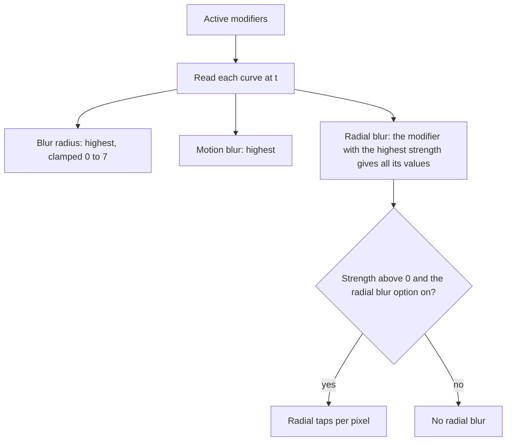

# Image space pass

The image space pass is the last full-screen pass of a frame. It applies the color grade of
the current place: saturation, brightness, contrast, tint, and fade. The record layout is in
[image space records](/formats/image-spaces.md); this page covers the runtime.

## Data flow

1. The weather system or the interior cell names a baseline `IMGS` each frame, as section
   "Resolution" of the format page explains.
2. Spells, explosions, and scripts start `IMAD` modifiers. Each one runs for its playback
   time, then ends; a looping one runs until it is stopped.
3. The pass reads the baseline with every modifier applied, clamps the values to a range the
   shader can show, and draws. A neutral result skips the pass, so a frame without an image
   space costs nothing.

Most grades read only the pixel they change. Those draw one fullscreen triangle inside the scene
pass, and the shader reads the pixel from tile memory, so the frame needs no copy and keeps its
depth [memoryless](/rendering/metal4-renderer.md). Blur, radial blur, motion blur, double
vision, and bloom read other pixels. For them the scene pass ends, the color is copied, and a second
pass grades the copy. The
[screen-space post effects](/rendering/post-effects.md) use the same split, and the composite
also runs when only they are on.

## HDR tone mapping

The game tone maps and grades the colour values it stores, with no sRGB step. Its shaders
work in gamma space, so OpenSky's pass first raises the linear scene colour to `1/2.2`, runs
the game's steps, and makes the result linear again. The behaviour below comes from a
clean-room read of the game's image space shaders and their per-frame values (2026-11-06),
checked with capture pairs against the reference game.

- **Measure.** Every 16th pixel in each direction adds its luminance, with the weights
  (0.2125, 0.7154, 0.0721), to two GPU counters per frame slot. The mean is a plain mean, not
  a log mean. The measured colour already holds the fog and the
  [volumetric light](/rendering/post-effects.md#volumetric-light), as in the game.
- **Quarters.** The game measures the scene down to a 2 x 2 grid, so each screen quarter has
  its own mean, X, and Y. A pixel reads them blended, as a linear sampler reads a 2 x 2
  texture: one quarter's values up to its centre, then a mix towards the next quarter. So a
  bright sky does not darken the ground below it through the contrast pivot.
- **Adapt.** Two values, X and Y, follow the mean M. Each frame each moves by `(M - old) *
  rate`, at least 1/256 and never past M. With `S = speed * 2`, `K = strength * 0.4`, and
  `n = 30 * seconds`, X uses the rate `1 - (1 - 0.01 S / K)^n` and Y `1 - (1 - 0.01 S)^n`.
  The speed is a percent of the gap per 1/30 s, as the CK wiki says.
- **Exposure** is `Y / X`. In a steady scene both equal M, so the exposure is 1. Adaptation
  only shows for a short time after the light changes, such as at a cave mouth. It never
  pushes a night scene towards a fixed brightness.
- **Curve.** On the pixel's luminance `L`, `x = L * Y / X` and
  `T = x * (1 + x / (1.1 white)²) / (1 + x)`. The colour is scaled by `T / L`.

The grade follows, in this order: luminance `g` of the mapped colour; saturation, a mix from
`g` towards the colour; tint, a mix towards `g` times the tint colour by the tint amount;
brightness, a multiply; contrast, `contrast * (c - X) + X`, which pivots around the adapted
luminance X, not 0.5; a clamp to 0 to 1; and the fade.

The launcher's graphics page holds the tone mapping switch. It turns the curve off; the
grade and the measurement still run. An image space with no white point skips the curve.

## Combining modifiers

The [CK wiki "ImageSpace Modifiers"](https://ck.uesp.net/wiki/ImageSpace_Modifiers) page gives
two rules, and OpenSky follows both:

- The tint RGB is the average of every active tint, weighted by its alpha. The alpha is the
  highest alpha. The baseline `IMGS` tint takes part like a modifier. A modifier's alpha is
  multiplied by its strength first.
- The blur radius and the double vision are the highest value over the active modifiers.

OpenSky also keeps the highest motion blur. The radial blur of the strongest modifier wins
with its whole shape: ramps, start points, and centre.

## Blur effects

A modifier's curves are read at `t = elapsed / duration`, clamped to 0 to 1, where the
duration is the second `DNAM` float. The key times in every curve use the same 0 to 1 range.
The modifier's strength multiplies the radial strength, the blur radius, the double vision,
the depth of field strength, and the fade and tint alpha. It does not multiply the radial
ramps and start points, the centre, or the motion blur.

- **Radial blur.** The centre is the `DNAM` centre, 0.5 and 0.5 (the screen centre) in the
  vanilla records. With the use-target flag the centre is the target's place on screen, or
  the screen centre when there is no target. For a pixel at distance `d` from the centre, in
  screen units with no aspect correction:
  - `up = strength × (1 − 1 / (1 + rampUp × (d − start)))` when `d > start`, else 0;
  - `down = strength × (1 − 1 / (1 + rampDown × (d − downStart)))` when `d > downStart`,
    else 0;
  - `amount = max(up − down, 0)`; the step is the unit vector toward the centre times
    `amount × 0.5`.

  The pixel averages taps at `k × step` for `k` from `−N` to `N`, all with the same weight.
  The radial blur quality option picks `N` = 2, 6, or 10: 5, 13, or 21 taps. The ramps are
  rates: a larger value reaches full strength sooner.
- **Full-screen blur.** The radius, rounded up to 1 to 7, picks a kernel of 3, 5, 7, up to 15
  taps. Below a radius of 1 the blurred picture is mixed over the sharp one with the radius
  as weight. From 1 up it replaces the sharp picture.
- **Motion blur.** The value is the highest over the active modifiers. How strong it looks
  on screen is not known. OpenSky keeps last frame's view-projection. For each pixel it finds
  where the same far-plane direction was last frame, so only the camera's turn makes a trail.
  The trail is 3 × `s / (1 - s)` frames of that motion, the trail of a frame blend that keeps
  `s` of the last frame. It is capped at a tenth of the screen.

Worked example, Whirlwind Sprint (`MAGShoutSprint03`, 3 s). The radial strength goes from 0
to 0.9 at `t` = 0.02, to 0.6 at 0.13, and to 0 at 0.4. The ramp up falls from 0.2 to 0.1,
the start is 0.1, and there is no ramp down. The blur radius peaks at 2.0 at `t` = 0.04 and
is 0 by 0.46. At 0.06 s (`t` = 0.02), a pixel at the screen corner (`d` ≈ 0.71) gets
`up = 0.9 × (1 − 1 / (1 + 0.2 × 0.61)) ≈ 0.098`, so its taps step 0.049 screen units toward
the centre: a strong streak. The VATS modifier (`VATSImod`) holds a radial strength of
0.125, a ramp up of 0.1, a start of 0.1, and a motion blur of 0.25.

## Bloom and light scales

- **Bloom.** It needs colour above 1, so it runs only with the HDR target on
  (`bUse64bitsHDRRenderTarget`). Three rings of 8 taps reach out to the `IMGS` bloom radius.
  One radius step is 4 pixels at a 1080-pixel-high frame; the CK wiki gives the range 1 to 7.
  Each tap adds what it holds above the bloom threshold. The sum is scaled by the bloom scale
  and added before tone mapping.
- **Sunlight and sky scale.** The CK wiki calls both "non-imagespace". They apply with either
  target. The sun colour is multiplied by the sunlight scale; vanilla values are 2 to 2.7.
  The sky scale is added, not multiplied: the dome draws its weather colours times the scene
  scale 1/1.2 ([output clamp](/rendering/surface-shading.md#output-clamp)), plus 1/1.2 times
  the sky scale, and the clouds add the same lift to their colour. Vanilla sky scales are
  small, such as 0.235 by day and 0.02 at night in clear weather, so the lift is a slight
  even brightening.

At most 16 modifiers run at once. The oldest goes first. This is OpenSky's own limit.

## Triggers

| Source | Strength |
| --- | --- |
| A spell hit on the player | 1, from the `MGEF` image-space modifier |
| An explosion | 1 − (d / r)², d the distance to the camera and r the `EXPL` image-space radius; a zero radius plays at 1. A close blast also swaps in a fixed modifier at 1 ([explosion effects](/engine/explosion-effects.md)) |
| `ImageSpaceModifier.Apply(float afStrength = 1.0)` or `PopTo(ImageSpaceModifier, float)` | The script's strength, clamped to 0 to 1 |
| `ImageSpaceModifier.ApplyCrossFade(float afFadeDuration = 1.0)` | Rises from 0 to 1 over the fade time, held until `Remove` or the global `RemoveCrossFade(float afFadeDuration = 1.0)`, which falls back to 0 over its own fade time |

A spell hit on another actor starts no modifier, because the modifier describes what the
player sees.

## Low health

Behaviour described from a clean-room read of `SkyrimSE.exe` 1.7.104.0 on 2026-11-06 (only the
behaviour was reported, no code). The share is the player's health over its maximum. The game
reads it each time the health changes.

- At or below `fPlayerHealthHeartbeatSlow` (0.2) the default object `IMLH` (`LowHealthImod`)
  pulses: the first pulse starts at once, then one every `fLowHealthIModInterval` (2 s). Each
  pulse is a new one-shot start. Its strength runs in a straight line from
  `fLowHealthIModStrengthMin` (0.8) at a share of 0.2 to `fLowHealthIModStrengthMax` (1.5) at
  `fPlayerHealthHeartbeatFast` (0.1), and stays 1.5 below that, even at 0.
- Above 0.2 no new pulse starts; a running one plays to its end.
- The heartbeat sound `HSSD` plays from above 0.1 up to 0.2, and `HFSD` above 0 up to 0.1. A
  change between the two stops the old one at once and starts the new one at full volume.
  Leaving both bands, by healing or by death, fades the sound out over
  `iPlayerHealthHeartbeatFadeMS` (1,000 ms). A heartbeat that ended starts again on the next
  health change in its band.

Loading a save stops the heartbeat at once, and starting a new game fades it out; both make
the cues read the health afresh. The maximum leaves out temporary modifiers, so a
fortify-health effect does not change when the cues start.
The launcher's "Low-health pulse" switch stands for the game's `bLowHealthIModEnabled`.

## Where OpenSky differs

- The scene renders into an 8-bit target, so tone mapping works on display-range color. With
  the game's `bUse64bitsHDRRenderTarget` on, the target is half-float in linear sRGB instead,
  and colour above 1 reaches the tone mapping. Only then does bloom draw. The game always
  renders to a float target.
- The bloom tap pattern, the radius step, and the receive-bloom threshold are not documented.
  OpenSky reads the receive threshold but does not use it.
- The radial blur takes 8 taps with a linear ramp, not the game's taps and curve above, and
  the full-screen blur is a 12-tap disc. Beside the game, Whirlwind Sprint and VATS showed no
  visible blur in OpenSky, only their tint. Motion blur follows only the camera's turn, not
  moving objects.
- Depth of field draws as a [post effect](/rendering/post-effects.md#depth-of-field) when its
  game option is on. Double vision is one ghost image offset to the side.
- A cross-fade rises and falls linearly over its fade time. The curve is OpenSky's choice.
  Only one cross-faded modifier is held, as in the game, and a new one replaces it; the old
  one fades out over the new one's fade time.
- Several fades lay over each other like alpha. The game holds one fade colour and amount
  from its modifiers; how it combines more than one is not known.
